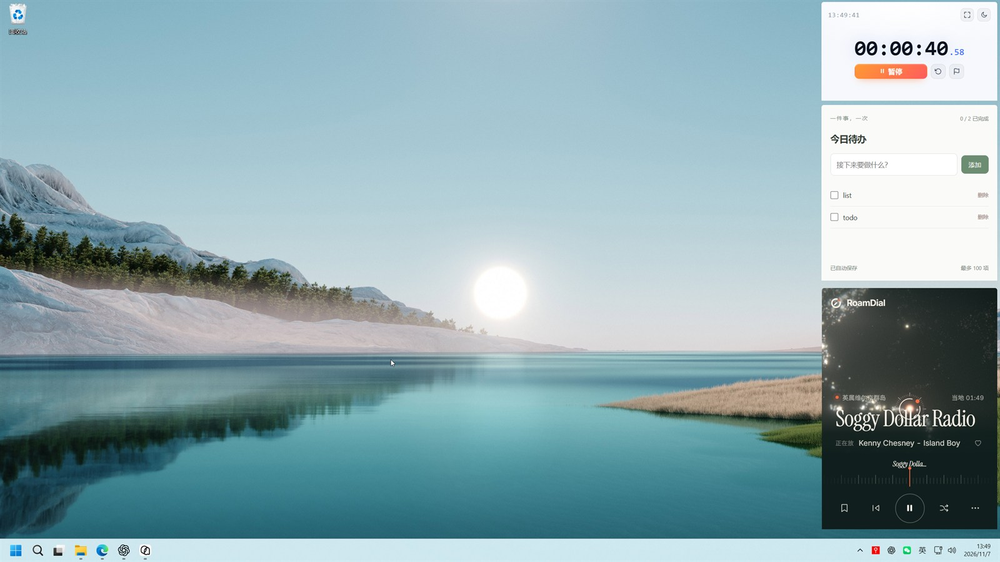
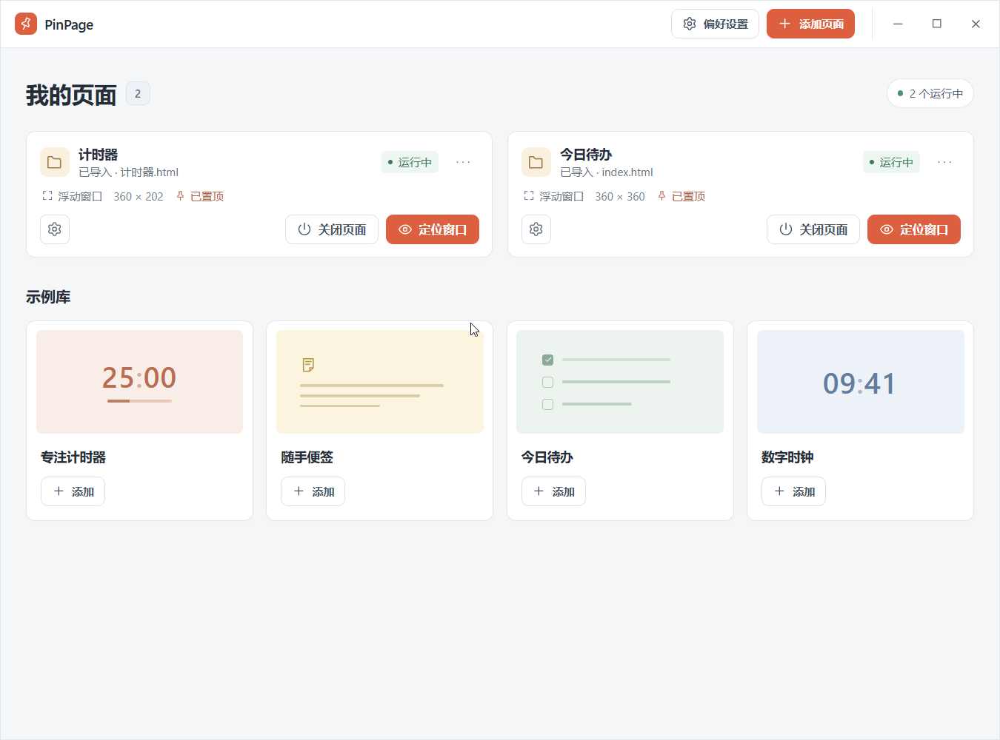
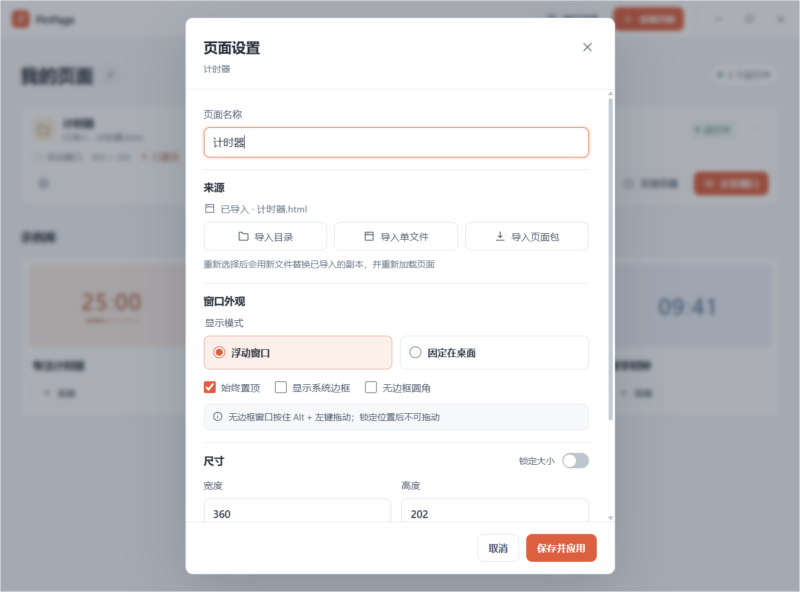

# PinPage

PinPage turns any web page into an always-visible desktop widget: online pages can float above other windows or be pinned to the desktop, while local HTML files can be imported and run directly—no browser tab, no app packaging.

PinPage is made for content you want at a glance: timers, dashboards, notes, monitoring pages, and local HTML tools generated with an LLM.

English | [简体中文](README.zh-CN.md)

## Screenshots

_Pages pinned above the desktop, always in view._

_The on-demand workspace: page cards, status, and quick actions._

_Source, window appearance, and size._

## Highlights

- **Pages above windows, not tabs** — float pages over other apps or pin them to the desktop; set always-on-top and a per-page frame style (system frame, borderless, or rounded borderless). Both borderless styles suppress the system shadow and outline; rounded borderless keeps native corner clipping.
- **Transparent backgrounds** — allow transparency per page in floating and desktop modes on Windows without reloading its running state. Built-in examples are adapted; other pages must provide transparent backgrounds. See [verification status](docs/acceptance.md).
- **Any web page or local HTML** — open HTTP/HTTPS addresses or import a folder or single HTML file, including LLM-generated tools that need no deployment or packaging; relative CSS, images, ES modules, and JSON keep working.
- **Portable page packages** — export an imported page with its localStorage, sessionStorage, IndexedDB, default window layout, and named window presets as a `.pinpage` package and restore it elsewhere. Built-in examples use the same format.
- **Precise window control** — logical size and physical position, independent position and size locks, modifier + left-drag for borderless windows, plain right-click for a window menu (per-page opt-out to let the page handle it), and DPI/monitor correction when restoring windows. The drag modifier defaults to Ctrl; choose Shift or Off in settings.
- **Immediate window settings** — appearance, size, position, and locks apply and save directly, with undo for the last adjustment. Names and sources are saved separately under Content.
- **One-click window presets** — package appearance, size, and relative position into your own presets and switch them in one step. Save the current window layout as a new preset or overwrite an existing one. Each page owns its preset list, with a per-page manager for editing, renaming, copying, and deleting templates without touching the current window; imported page packages can carry a default layout.
- **Quiet by design** — floating pages skip the taskbar; the workspace is created on demand and destroyed on close; the tray keeps windows recoverable.
- **Optional launch at startup** — enable it in Settings → General; off by default. Start in the tray when signing in to Windows, with page restoration controlled separately.
- **Security boundaries** — separate WebViews for the workspace and page content, a scoped custom protocol for local files, and no shell or window-management permissions for untrusted pages; read-only folder access is granted per page through a native picker.
- **Page native capabilities** — content pages can read host info and a shared once-per-second system sample by default; read-only folder access is bounded to the granted root and never exported with packages. Page scripts stay same-origin while HTTPS outbound is allowed. See [architecture notes](docs/architecture.md).
- **Bilingual UI** — Simplified Chinese and English, or follow the system UI language on Windows; switching does not reload open pages.
- **GitHub Release updates** — check, download, verify, and install signed updates from this repository; installation requires confirmation. End-to-end Windows upgrade acceptance is pending; see [versioning and updates](docs/releases.md).
- **Seven built-in tools** — time tools (focus timer, clock and stopwatch), notes & tasks, calendar & countdown, Kanban board, market watch, folder browser, and system monitor. Each creates an independent page with named window layouts; market watch requires the internet, and folder access requires per-page authorization.
- **Market watch** — available in the built-in gallery with intraday charts, local watchlist filtering, display sorting, color conventions, and transparent panels. Failed requests keep cached data; see [data sources and limitations](examples/stocks/README.md).
- **Measured footprint** — first-round Release sampling measured about 205 / 291 / 377 MiB of private commit memory for 1 / 3 / 5 idle timers across the whole process group. Details are in the [architecture notes](docs/architecture.md).

## Quick start

1. Download the Windows installer from [GitHub Releases](../../releases/latest) and install it.
2. Click "Add page" and enter a web address, import a local page, or add a sample.
3. Choose Floating window or Pinned to desktop under "Window options", then create the page.
4. Reopen the workspace from the tray. Right-click a page to open its window menu: switch presets at the top, or choose "Page settings…" to open the manager with that page's settings dialog. Hold Ctrl (default) and left-drag to move a borderless window; change or disable the drag modifier in Settings → Controls.

Full instructions live in the [user guide](docs/user-guide.md) (Chinese). To build from source, see [Development and build](docs/development.md).

Windows x64 [v0.3.0](https://github.com/LLMxPM/pinpage/releases/tag/v0.3.0) adds transparent desktop tools, page-scoped presets, the bundled CLI, and seven examples. Users on v0.2.0 can use in-app updates; users on v0.1.0 need to install manually. See the [release notes](docs/release-notes/0.3.0.md) (Chinese).

Windows is the fully supported platform. macOS is experimental: default builds expose standard floating windows, while `experimental-macos-drag` enables a fixed Option-drag implementation for community testing. Desktop mode, rounded corners, transparent backgrounds, window locks, and configurable gestures remain unavailable. Both macOS variants passed ARM64 CI checks, tests, and verification bundle builds, and core window flows have been verified on one Apple Silicon Mac; Intel, Retina, multi-display, import/page-package, and gesture-boundary acceptance are still pending. See [Platform support](docs/platforms.md) and [macOS development and verification](docs/macos-development.md) (Chinese).

## Documentation

- [User guide](docs/user-guide.md) (Chinese) — install, pages, window control, tray, data migration, FAQ.
- [Architecture and data](docs/architecture.md) (Chinese) — window lifecycle, security boundaries, local copies, page packages, configuration, performance.
- [Example development and integration](docs/examples-development.md) (Chinese) — examples follow repository `AGENTS.md` and reuse the shared references from the single `pinpage-pages` skill; covers registration, packaging, and verification.
- [Agent CLI and skill](docs/agent-cli.md) (Chinese) — a dedicated "Agents and CLI" panel in the workspace toolbar; implemented in current source: app-bundled CLI, page updates, named window presets, page package export, desktop screenshots, diagnostics and portable skill management; included in v0.3.0. See the [implementation plan](docs/agent-cli-plan.md) and [acceptance status](docs/acceptance.md).
- [Development and build](docs/development.md) (Chinese) — environment, checks, packaging, verification instances, and acceptance scripts.
- [Implementation and acceptance status](docs/acceptance.md) (Chinese) — implementation status, check results, desktop verification records, and pending acceptance.
- [Platform support](docs/platforms.md) (Chinese) — Windows capabilities, macOS floating-window fallback, and acceptance status.
- [macOS development and verification](docs/macos-development.md) (Chinese) — setup, default and experimental builds, CI artifacts, and community test reports.
- [Versioning and updates](docs/releases.md) (Chinese) — version scripts, signed builds, GitHub Release publishing, and update behavior.

## License

PinPage is released under the [MIT License](LICENSE).
