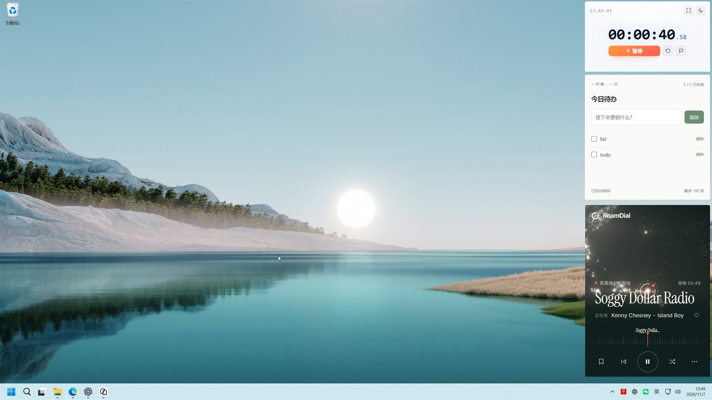
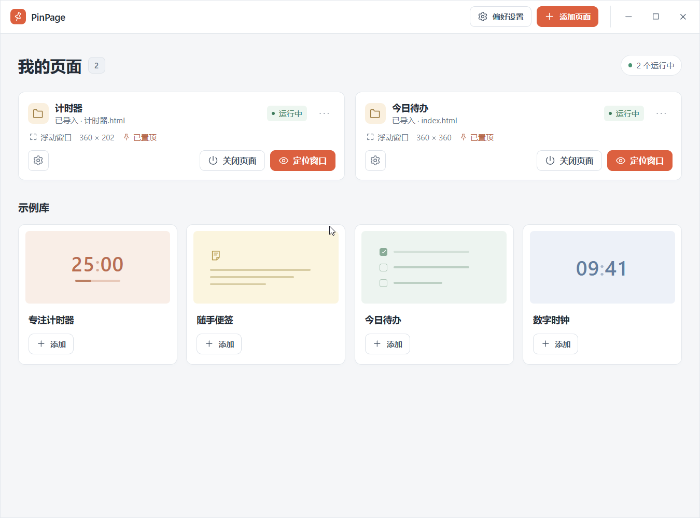
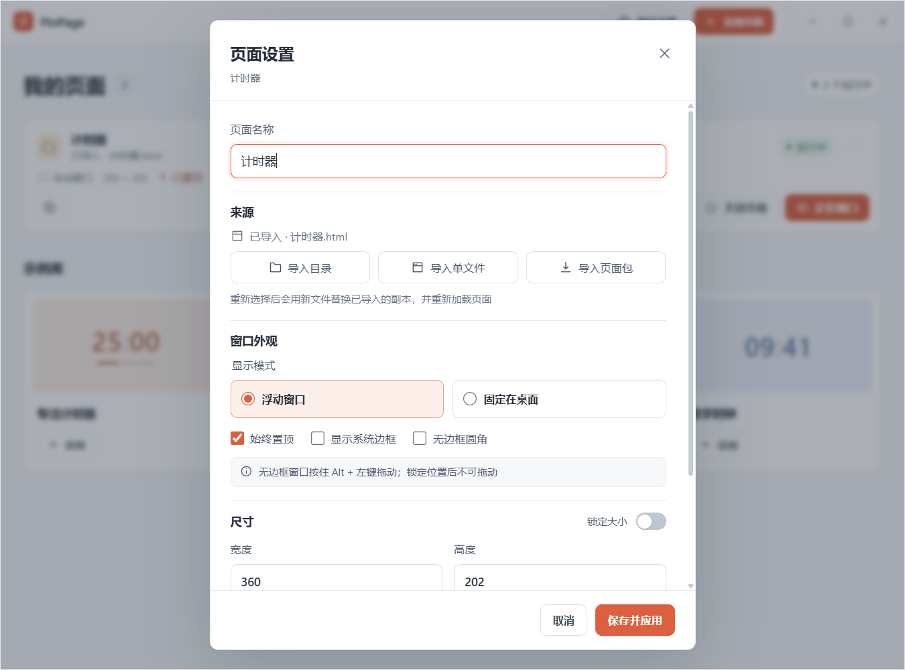

# PinPage

PinPage turns any web page into an always-visible desktop widget: online pages can float above other windows or be pinned to the desktop, while local HTML files can be imported and run directly—no browser tab, no app packaging.

PinPage is made for content you want at a glance: timers, dashboards, notes, monitoring pages, and local HTML tools generated with an LLM.

English | [简体中文](README.zh-CN.md)

## Screenshots

*Pages pinned above the desktop, always in view.*

*The on-demand workspace: page cards, status, and quick actions.*

*Source, window appearance, and size.*

## Highlights

- **Pages above windows, not tabs** — float pages over other apps or pin them to the desktop; set always-on-top and borderless rounded corners per page.
- **Any web page or local HTML** — open HTTP/HTTPS addresses or import a folder or single HTML file, including LLM-generated tools that need no deployment or packaging; relative CSS, images, ES modules, and JSON keep working.
- **Portable page packages** — export an imported page with its localStorage, sessionStorage, and IndexedDB as a `.pinpage` package and restore it elsewhere.
- **Precise window control** — logical size and physical position, independent position and size locks, `Alt + left-drag` for borderless windows, and DPI/monitor correction when restoring windows.
- **Quiet by design** — floating pages skip the taskbar; the workspace is created on demand and destroyed on close; tray and global shortcuts keep windows recoverable.
- **Security boundaries** — separate WebViews for the workspace and page content, a scoped custom protocol for local files, and no filesystem, shell, or window-management permissions for untrusted pages.
- **Bilingual UI** — Simplified Chinese and English, or follow the Windows UI language; switching does not reload open pages.
- **Four offline tools built in** — focus timer, quick notes, daily checklist, and digital clock, each added as an independent imported page.
- **Measured footprint** — first-round Release sampling measured about 205 / 291 / 377 MiB of private commit memory for 1 / 3 / 5 idle timers across the whole process group. Details are in the [architecture notes](docs/architecture.md).

## Quick start

1. Download the Windows installer from [GitHub Releases](../../releases/latest) and install it.
2. Click "Add page" and enter a web address, import a local page, or add a sample.
3. Choose Floating window or Pinned to desktop under "Window options", then create the page.
4. Reopen the workspace with `Ctrl+Alt+P`, recover all windows with `Ctrl+Alt+B`, and drag borderless windows with `Alt + left-drag`.

Full instructions live in the [user guide](docs/user-guide.md) (Chinese). To build from source, see [Development and build](docs/development.md).

## Documentation

- [User guide](docs/user-guide.md) (Chinese) — install, pages, window control, tray and shortcuts, data migration, FAQ.
- [Architecture and data](docs/architecture.md) (Chinese) — window lifecycle, security boundaries, local copies, page packages, configuration, performance.
- [Development and build](docs/development.md) (Chinese) — environment, checks, packaging, verification instances.
- [Verification log](docs/verification.md) (Chinese) — implemented and verified items, performance data, pending acceptance scenarios.

## License

PinPage is released under the [MIT License](LICENSE).
