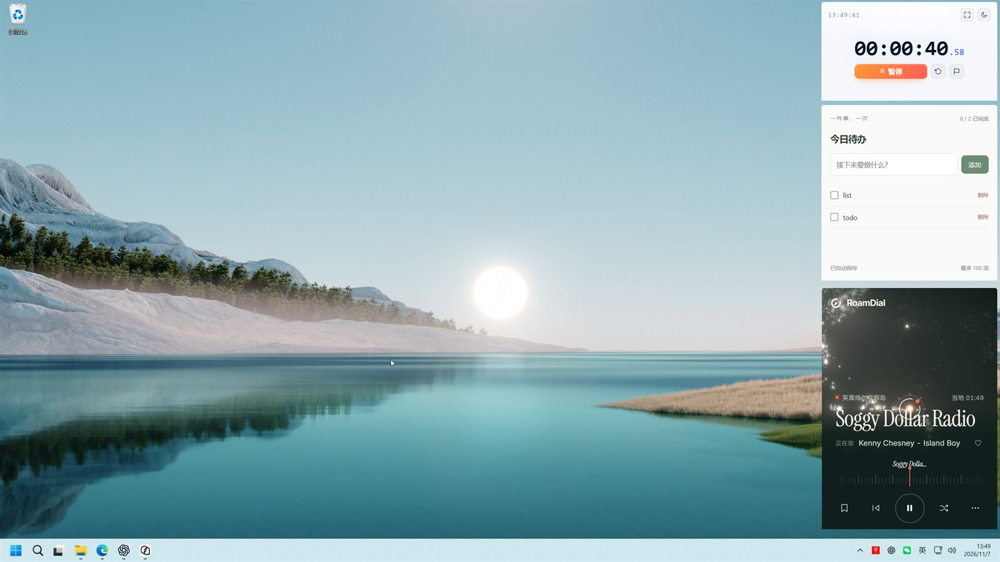

# PinPage

PinPage 把任意网页变成常驻桌面的小工具：在线页面可以浮在其他窗口上方或固定在桌面，本地 HTML 直接导入即可运行，不占浏览器标签，也不用单独打包成应用。

PinPage 适合需要随时瞥一眼的内容：计时器、看板、便签、监控页，以及越来越多用大模型生成的本地 HTML 小工具。

[English](README.md) | 简体中文

## 截图

*把需要常驻的页面固定在桌面之上，随时可见。*

*按需打开的工作台：页面卡片、状态与快捷操作。*

*来源、窗口外观与尺寸。*

## 项目特点

- **悬浮在窗口之上，而不是浏览器标签**：页面可以浮动在其他应用上方，也可以固定在桌面；逐页设置置顶与无边框圆角。
- **网页和本地页面都能用**：支持 HTTP/HTTPS 地址，也可以导入目录或单个 HTML；大模型生成的本地小工具无需部署或打包即可运行，相对路径的 CSS、图片、ES 模块和 JSON 正常工作。
- **页面包可迁移**：导入页连同 localStorage、sessionStorage 与 IndexedDB 一起导出为 `.pinpage`，在别处恢复。
- **窗口控制精确**：逻辑尺寸与物理坐标、独立的位置锁和大小锁；修饰键 + 左键拖动无边框窗口，修饰键 + 右键打开窗口菜单。共用修饰键默认左 Alt，可改为 Ctrl、Shift 或关闭；DPI 或显示器变化后恢复窗口仍可找回。
- **窗口设置即时生效**：外观、尺寸、位置与锁定修改后直接生效并保存，支持撤销上次调整；名称和来源在「内容」中单独保存。
- **窗口预设一键切换**：全屏悬浮（不置顶）、标准窗口、右上角悬浮、右下角桌面（320 × 480）四个内置预设，把外观、尺寸和相对位置一起切换；调整后可另存或覆盖自定义预设。共用管理器支持编辑、重命名、复制和删除，模板修改不联动现有页面。
- **低打扰**：悬浮页不占任务栏，工作台按需创建、关闭即销毁，托盘随时找回窗口。
- **安全边界清晰**：工作台与内容页使用独立 WebView，本地资源走受控自定义协议，不受信任页面不获得文件系统、Shell 或窗口管理权限。
- **中英文界面**：简体中文、英文或跟随系统（当前为 Windows），切换语言不重载已打开的页面。
- **GitHub Release 升级**：从本仓库检查、下载并验签更新，确认后安装；Windows 升级端到端仍待验收，详见[版本与升级](docs/releases.md)。
- **四个离线工具**：专注计时器、随手便签、今日待办和数字时钟，添加后作为独立导入页管理。
- **有实测数据**：首轮 Release 采样中，1、3、5 个静置计时器的整组私有提交内存约为 205 / 291 / 377 MiB，详见[架构与数据](docs/architecture.md)。

## 快速开始

1. 从 [GitHub Releases](../../releases/latest) 下载 Windows 安装包并安装。
2. 点击「添加页面」，输入网页地址、导入本地页面，或直接从示例库添加工具。
3. 在「窗口选项」中选择浮动窗口或固定在桌面，创建并开启页面。
4. 从托盘重新打开工作台。默认先按住左 Alt，再用左键拖动无边框窗口移动位置，或在页面上 Alt+右键打开窗口菜单；Alt+右键需先松开右键、再松开 Alt，菜单才会显示。可在「设置 → 操作」中修改或关闭手势修饰键。

完整操作见[用户指南](docs/user-guide.md)。从源码构建见[开发与构建](docs/development.md)。

当前 Windows x64 正式版为 [v0.2.0](https://github.com/LLMxPM/pinpage/releases/tag/v0.2.0)，首次接入应用内更新；v0.1.0 用户需要先手动安装一次这一版。

Windows 为完整支持平台；macOS 为实验性平台，默认只声明标准浮动窗口，`experimental-macos-drag` 可显式启用固定 Option 拖动供社区验证。桌面模式、圆角、窗口锁与可配置手势仍不可用。两种 macOS 构建均通过 ARM64 CI 检查、测试与验证包构建，核心窗口流程已在一台 Apple Silicon Mac 上实机通过；Intel、Retina、多显示器、导入与页面包及手势边界仍待验收，详见[平台支持](docs/platforms.md)和[macOS 开发与社区验收](docs/macos-development.md)。

## 文档

- [用户指南](docs/user-guide.md)：安装启动、页面管理、窗口操作、托盘、数据迁移与常见问题。
- [架构与数据](docs/architecture.md)：窗口生命周期、安全边界、本地副本、页面包、配置模型与性能。
- [开发与构建](docs/development.md)：环境准备、检查与测试、打包、独立验证实例与当前验收状态。
- [平台支持](docs/platforms.md)：Windows 完整能力、macOS 浮动窗口回退与待验收范围。
- [macOS 开发与社区验收](docs/macos-development.md)：环境、默认与实验构建、CI 验证包和实机报告。
- [版本与升级](docs/releases.md)：版本脚本、签名构建、GitHub Release 发布与客户端升级行为。

## 许可证

PinPage 以 [MIT 许可证](LICENSE) 开源。
