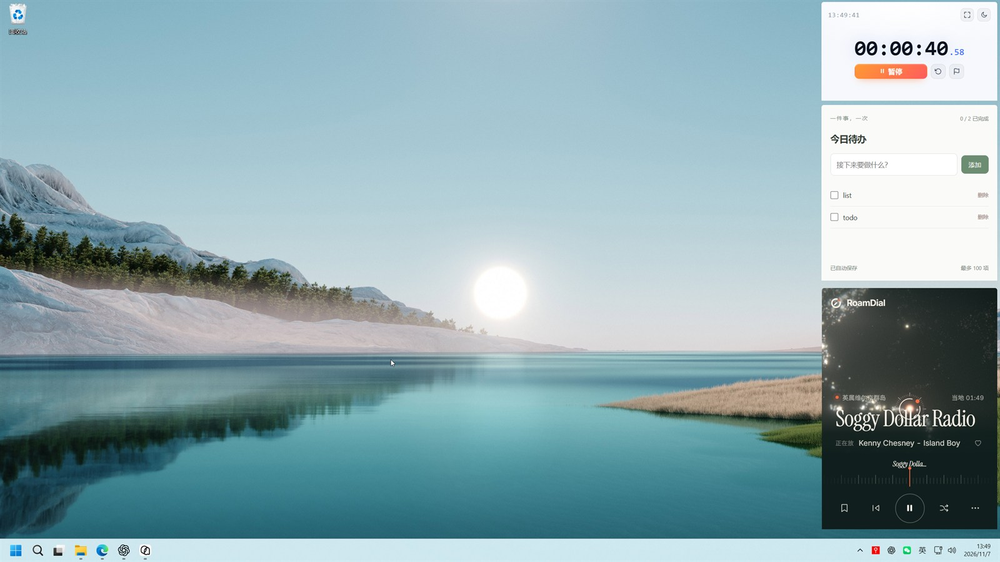
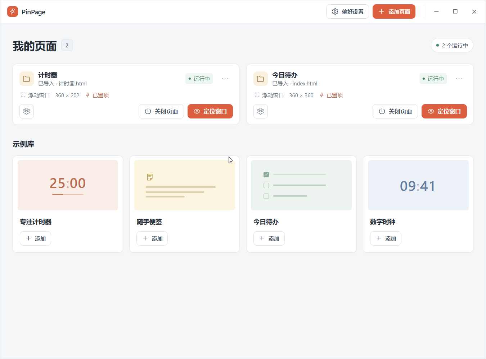
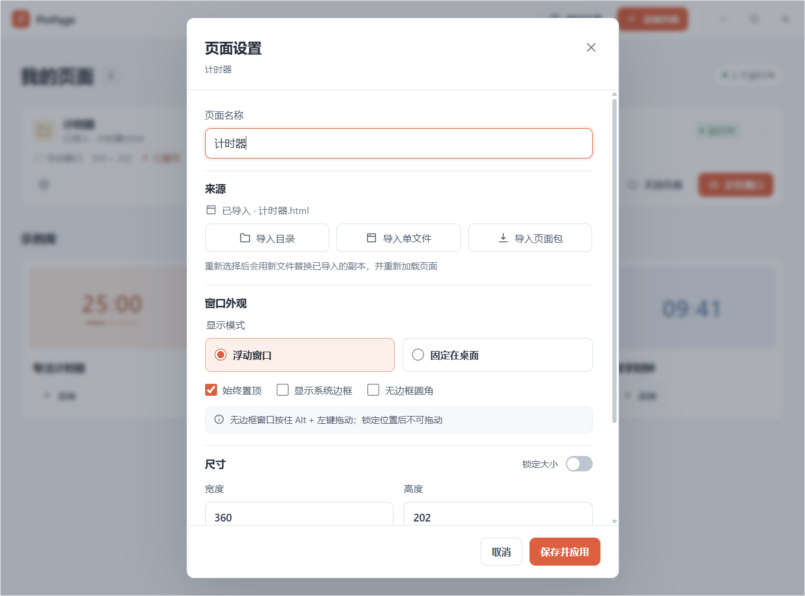

# PinPage

PinPage 把任意网页变成常驻桌面的小工具：在线页面可以浮在其他窗口上方或固定在桌面，本地 HTML 直接导入即可运行，不占浏览器标签，也不用单独打包成应用。

PinPage 适合需要随时瞥一眼的内容：计时器、看板、便签、监控页，以及越来越多用大模型生成的本地 HTML 小工具。

[English](README.md) | 简体中文

## 截图

_把需要常驻的页面固定在桌面之上，随时可见。_

_按需打开的工作台：页面卡片、状态与快捷操作。_

_来源、窗口外观与尺寸。_

## 项目特点

- **悬浮在窗口之上，而不是浏览器标签**：页面可以浮动在其他应用上方，也可以固定在桌面；逐页设置置顶与边框样式（系统边框／无边框／无边框圆角）。两种无边框样式均关闭系统阴影和描边，圆角样式保留原生圆角裁剪。
- **透明背景**：Windows 浮动页与桌面页均可逐页允许背景透明，切换时保留页面运行状态；内置示例已适配，其他网页需提供透明背景。实际验收范围见[当前状态与验收](docs/acceptance.md)。
- **网页和本地页面都能用**：支持 HTTP/HTTPS 地址，也可以导入目录或单个 HTML；大模型生成的本地小工具无需部署或打包即可运行，相对路径的 CSS、图片、ES 模块和 JSON 正常工作。
- **页面包可迁移**：导入页连同 localStorage、sessionStorage、IndexedDB、默认窗口布局与命名预设列表一起导出为 `.pinpage`，在别处恢复；内置示例也使用同一格式。
- **窗口控制精确**：逻辑尺寸与物理坐标、独立的位置锁和大小锁；修饰键 + 左键拖动无边框窗口，直接右键打开窗口菜单（可按页面交给网页处理）。拖动修饰键默认 Ctrl，可改为 Shift 或关闭；DPI 或显示器变化后恢复窗口仍可找回。
- **窗口设置即时生效**：外观、尺寸、位置与锁定修改后直接生效并保存，支持撤销上次调整；名称和来源在「内容」中单独保存。
- **窗口预设一键切换**：把外观、尺寸和相对位置打包成自定义预设，一次切换；用「另存为新预设」保存当前窗口配置，调整后可覆盖更新。预设归属单个页面、各自维护模板列表，页面级管理器支持编辑、重命名、复制和删除，模板修改不联动现有窗口；导入页面包时可应用随包默认布局。
- **低打扰**：悬浮页不占任务栏，工作台按需创建、关闭即销毁，托盘随时找回窗口。
- **可选开机自启**：在「设置 → 通用」开启，默认关闭；登录 Windows 后启动到托盘，可独立选择是否恢复上次开启的页面。
- **安全边界清晰**：工作台与内容页使用独立 WebView，本地资源走受控自定义协议，不受信任页面不获得 Shell 或窗口管理权限；文件夹只读需经原生选择器逐页授权。
- **页面原生能力**：内容页默认可读宿主信息与约每秒一次的共享系统采样；文件夹只读以所选根目录为边界，不随页面包导出；页面脚本仅同源，出站允许 HTTPS。详见[架构与数据](docs/architecture.md)。
- **中英文界面**：简体中文、英文或跟随系统（当前为 Windows），切换语言不重载已打开的页面。
- **GitHub Release 升级**：从本仓库检查、下载并验签更新，确认后安装；Windows 升级端到端仍待验收，详见[版本与升级](docs/releases.md)。
- **七个内置工具**：时间工具（专注计时、时钟与秒表）、便签与待办、日历与倒数日、轻量看板、自选行情、文件夹和系统监控。各自生成独立页面并附带命名窗口布局；行情需要联网，文件夹需逐页授权。
- **自选行情**：已接入示例库，支持真实分时、本地筛选、展示排序、涨跌配色与透明底板；行情失败保留缓存，数据来源及限制见[使用说明](examples/stocks/README.md)。
- **有实测数据**：首轮 Release 采样中，1、3、5 个静置计时器的整组私有提交内存约为 205 / 291 / 377 MiB，详见[架构与数据](docs/architecture.md)。

## 快速开始

1. 从 [GitHub Releases](../../releases/latest) 下载 Windows 安装包并安装。
2. 点击「添加页面」，输入网页地址、导入本地页面，或直接从示例库添加工具。
3. 在「窗口选项」中选择浮动窗口或固定在桌面，创建并开启页面。
4. 从托盘重新打开工作台。在页面上直接右键打开窗口菜单：顶部直接切换窗口预设，或点「页面设置…」打开管理界面并直达该页设置。默认按住 Ctrl 用左键拖动无边框窗口移动位置，可在「设置 → 操作」中修改或关闭拖动修饰键。

完整操作见[用户指南](docs/user-guide.md)。从源码构建见[开发与构建](docs/development.md)。

Windows x64 [v0.3.0](https://github.com/LLMxPM/pinpage/releases/tag/v0.3.0) 新增透明桌面工具、页面级预设、随包 CLI 和七个示例。v0.2.0 用户可使用应用内更新；v0.1.0 用户需手动安装，详见[更新说明](docs/release-notes/0.3.0.md)。

Windows 为完整支持平台；macOS 为实验性平台，默认只声明标准浮动窗口，`experimental-macos-drag` 可显式启用固定 Option 拖动供社区验证。桌面模式、圆角、背景透明、窗口锁与可配置手势仍不可用。两种 macOS 构建均通过 ARM64 CI 检查、测试与验证包构建，核心窗口流程已在一台 Apple Silicon Mac 上实机通过；Intel、Retina、多显示器、导入与页面包及手势边界仍待验收，详见[平台支持](docs/platforms.md)和[macOS 开发与社区验收](docs/macos-development.md)。

## 文档

- [用户指南](docs/user-guide.md)：安装启动、页面管理、窗口操作、托盘、数据迁移与常见问题。
- [架构与数据](docs/architecture.md)：窗口生命周期、安全边界、本地副本、页面包、配置模型与性能。
- [示例开发与接入](docs/examples-development.md)：示例通过仓库 `AGENTS.md` 复用唯一的 `pinpage-pages` 技能公共规范，涵盖注册、打包与验证。
- [智能体 CLI 与 skill](docs/agent-cli.md)：工作台顶栏提供独立的「智能体与 CLI」面板；当前源码已接入随应用分发的 CLI、页面更新、命名窗口预设、页面包导出、桌面截图、诊断与独立技能管理，随 v0.3.0 分发；另见[实施规划](docs/agent-cli-plan.md)与[验收状态](docs/acceptance.md)。
- [开发与构建](docs/development.md)：环境准备、检查与测试、打包、独立验证实例与验收脚本。
- [当前状态与验收](docs/acceptance.md)：实现状态、自动检查结果、桌面实测记录与待验收项。
- [平台支持](docs/platforms.md)：Windows 完整能力、macOS 浮动窗口回退与待验收范围。
- [macOS 开发与社区验收](docs/macos-development.md)：环境、默认与实验构建、CI 验证包和实机报告。
- [版本与升级](docs/releases.md)：版本脚本、签名构建、GitHub Release 发布与客户端升级行为。

## 许可证

PinPage 以 [MIT 许可证](LICENSE) 开源。
