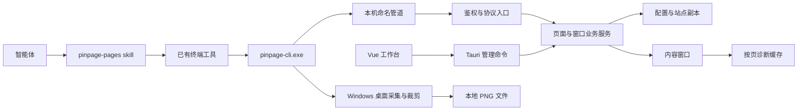

# PinPage 智能体 CLI 与 skill 实施规划

日期：2026-11-11。状态：主体实现已落地，发布验收尚未全部完成。本文保留设计基准，使用方式见[CLI 指南](agent-cli.md)，实际实测与未覆盖项以[当前状态与验收](acceptance.md)为准，不能把下列完整矩阵视为已验收。

PinPage 将随应用安装提供 `pinpage-cli.exe`，不提供独立 CLI 下载；配套 `pinpage-pages` skill 支持独立安装、更新和导出，安装目标可以是指定目录或用户的 `~/.agents/skills`。具备本机终端与图片查看能力的智能体可据此完成页面制作、安装、更新、桌面截图和诊断。对外只提供 CLI，不实现 MCP 服务。截图以真实桌面合成画面为依据，覆盖透明背景、原生边框、圆角、阴影和窗口层级。

## 一 目标与交付范围

### 核心目标

智能体能够在不操作工作台文件选择器、不编辑应用数据目录的情况下，完成以下流程：

1. 在工作目录生成或修改页面源码。
2. 检查 CLI、应用版本、连接状态与可用能力。
3. 安装页面并取得稳定的页面 ID。
4. 将新源码更新到同一页面，保留窗口配置和既有 Web 存储。
5. 读取加载状态、控制台异常与资源失败记录。
6. 截取实际桌面画面，检查布局、透明效果与原生外框。
7. 修正源码后再次更新和验证，输出页面位置、截图及验收结论。

首版面向 Windows x64、当前用户的交互桌面和同时运行 1～5 个页面。其他平台通过能力探测明确返回不支持，不承诺跨平台截图一致性。

### 已确定的产品选择

| 事项 | 选择 |
| --- | --- |
| 对外入口 | 只提供 CLI，不同时维护 MCP |
| 智能体接入 | skill 指导智能体调用已有终端工具 |
| 进程方式 | CLI 按命令启动，执行完成退出，无独立常驻代理 |
| 本机连接 | Windows 命名管道，连接已运行的 PinPage |
| 应用状态 | 应用进程是配置、页面副本与窗口状态的唯一写入者 |
| 截图方式 | CLI 采集真实桌面，可按页面区域裁剪或截取指定显示器 |
| 调试方式 | 应用内部按页采集诊断，不开放外部 CDP 端口 |
| 权限模型 | 自动化客户端独立鉴权，内容页权限与 CSP 保持原有边界 |
| 调用体验 | 有限时等待、JSON 输出、明确退出码，不弹逐次确认框 |
| 分发方式 | CLI 只随应用安装与升级，不提供独立下载；skill 支持独立安装、更新和导出 |
| skill 安装目标 | 默认用户的 `~/.agents/skills`，也可指定其他 skills 根目录 |

### 首版必交付

- 连接检查、实例发现、页面列表和详情查询。
- 目录、单 HTML、`.pinpage` 包及 HTTP/HTTPS 页面安装。
- 对既有页面更新本地来源，以及刷新、开启、关闭和带到前面。
- 局部修改尺寸、位置、窗口模式、边框、透明与锁定参数。
- 按页面桌面区域截图、指定显示器截图和显示器枚举。
- 按页启停诊断、读取有界日志、区分加载错误与脚本错误。
- 可取消的等待、操作查询、冲突检测和安装重试去重。
- 自包含的 `pinpage-pages` skill、命令参考和页面制作规范，以及指定目录或用户级目录的 skill 安装、更新与导出。

### 后续范围

页面包导出与命名窗口预设管理已在 2026-11-12 增量实现，实测范围见开发文档；通用离线打包、内置示例命令安装、DOM 快照、选择器点击、输入和按键仍属后续范围。skill 导出与页面包导出分别定义。首版不提供任意 JavaScript 执行、任意 CDP 方法转发、全局桌面鼠标键盘控制、远程服务、自动源码监听或持续录屏，也不自动安装与升级 PinPage 本体。

## 二 当前基础与改造点

| 模块 | 已有基础 | 本次改造 |
| --- | --- | --- |
| [管理命令](../src-tauri/src/commands.rs) | 快照、创建页面、页面操作 | 提取共用业务服务，创建返回页面 ID 与操作结果 |
| [导入会话](../src-tauri/src/commands/session.rs) | 原生选择器导入、包导出 | 增加已认证本机路径输入，保留原有选择器入口 |
| [来源准备](../src-tauri/src/source.rs) | 票据校验、复制与数据恢复 | 区分安装和更新的数据策略，管理调用方授权 |
| [站点副本](../src-tauri/src/import.rs) | 暂存目录、目录交换、数量与大小限制 | 延长旧副本保留期，覆盖配置提交与崩溃恢复 |
| [内容与窗口编辑](../src-tauri/src/windows/editor.rs) | 局部窗口事务、来源更新 | 保留业务校验，补充结果状态和并发冲突处理 |
| [页面生命周期](../src-tauri/src/windows/events.rs) | 开启、加载、可见状态与错误 | 为导航增加代次，支撑准确等待与截图关联 |
| [平台适配](../src-tauri/src/platform/appearance.rs) | UI 线程访问 WebView2 的既有模式 | 接入按页诊断，不改变页面管理权限 |
| [页面技能](../skills/pinpage-pages/SKILL.md)与[示例接入文档](examples-development.md) | 页面制作与宿主能力规范、仓库示例接入 | 统一维护一份技能，仓库通过 AGENTS.md 与接入文档引用公共参考 |

当前管理命令要求工作台标签与来源校验，导入依赖原生选择器签发的一次性票据。CLI 不能伪装工作台，也不能通过删除 `ensure_manager` 校验接入。应将业务职责下沉，由工作台入口与自动化入口分别校验身份，再调用同一服务。

现有来源替换已有暂存与交换基础，但自动化接口需要进一步保证：站点文件与配置作为一个可恢复的提交处理；提交失败仍能使用旧副本；加载失败不能被包装成“页面已验证”。现有函数不能未经补充便当作这些目标全部满足。

## 三 架构与模块职责



### CLI

采用独立 Rust 控制台二进制，不复用现有 GUI 主入口；二进制独立运行，但仅随应用分发。解析参数、连接实例、打印结果、采集桌面并写入用户指定的输出位置，同时提供独立的 skill 安装、更新和导出操作；不直接读写 `settings.json`、站点副本或 WebView 用户数据。CLI 不需要 Node.js、Python 或用户克隆源码仓库。

CLI 与桌面应用共享协议类型，不依赖 Vue，也不通过工作台 WebView 中转请求。`--help`、`--version`、skill 安装／更新／导出、显示器枚举和指定显示器截图可在应用未启动时执行；按页面操作必须先连接目标应用实例。skill 文件写入由专门的安装模块处理，与应用配置和站点副本的写入权限分开。

### 应用控制入口

控制入口负责身份、输入、协议版本、方法权限与目标页面检查，再将请求交给业务服务。受信任工作台原有鉴权继续保留；内容页无法获得管道凭据、调用自动化管理方法或读取其他页面诊断。

管道接受连接采用事件或异步 I/O；空闲时不轮询进程、窗口或桌面。窗口创建、COM 与窗口子类化继续遵守 UI 线程约束，文件复制和等待放到工作线程或异步任务。等待回调时不持有会阻塞 UI 回调的全局操作锁。

### 建议模块组织

| 位置 | 职责 |
| --- | --- |
| `crates/pinpage-cli/` | 控制台入口、命令路由、连接、输出与桌面采集 |
| `crates/pinpage-protocol/` | 请求、响应、版本、能力与错误类型，避免引入 Tauri |
| `src-tauri/src/automation/` | 管道服务、鉴权、分发、操作登记、诊断会话与恢复元数据 |
| `src-tauri/src/services/` | 从现有命令抽出的页面安装、更新和窗口业务职责 |
| `skills/pinpage-pages/` | 随应用内置、可独立安装更新与导出的 skill 源文件和必要参考资料 |

以上路径为逻辑划分，实施时按实际职责拆分，不提前生成空模块。Cargo 构建布局需保持现有 `--manifest-path src-tauri/Cargo.toml`、版本校验、签名构建和验证实例流程可用；若引入 workspace 与共享锁文件，在同一阶段完成脚本迁移和验证。

## 四 本机连接与权限

### 实例发现与启动

每个应用实例在本用户的本地运行目录发布描述文件，包含应用标识、进程 ID、登录会话、随机 `instanceId`、管道名、协议版本与凭据。描述文件使用当前登录会话可访问的 ACL，凭据不进入标准输出、日志、页面配置或包文件。

CLI 默认连接正式应用标识 `com.pinpage.desktop`。开发、验证与正式实例必须使用不同应用标识，并通过 `--instance <应用标识>` 明确选择；多个候选或描述文件不匹配时返回错误，不猜测目标。

普通操作在未启动时返回 `appNotRunning`。`app start` 才会启动匹配标识的应用并等待连接，不默认打开工作台，也不启动第二个实例。验证实例应支持显式 `--app-path`，校验启动结果的应用标识；路径按系统参数数组传递，不拼接 shell 命令。CLI 不隐式退出应用或修改开机自启。

### 身份与访问边界

- 管道设置当前登录 SID 的显式 DACL，拒绝远程客户端，限制客户端创建管道实例的权限；服务端首次创建时防止同名管道被抢占。依据见 [Windows 管道权限](https://learn.microsoft.com/en-us/windows/win32/ipc/named-pipe-security-and-access-rights)及 [CreateNamedPipeW](https://learn.microsoft.com/en-us/windows/win32/api/namedpipeapi/nf-namedpipeapi-createnamedpipew)。
- 连接握手校验凭据、登录会话和协议；客户端校验管道服务进程与实例描述一致，避免把凭据交给错误服务。
- 凭据按应用进程启动轮换。连接断开、应用退出或禁用控制入口后释放相关句柄；旧实例描述和凭据不能用于新进程。
- 默认允许通过上述校验的本用户 CLI 操作当前实例，应用提供关闭本机控制的设置。CLI 命令表达本次操作意图，不增加逐次模态确认；禁用状态必须明确返回，不能自动重新开启。
- 该边界用于隔离网页、其他用户、其他登录会话和错误实例，不作为防御已完全控制同一用户账户的恶意进程的承诺。
- 页面安装所需的源码路径属于本次本机命令输入，不等同于授予内容页读取该源码目录的能力。内容页只访问安装后的站点副本。
- L1 文件夹只读仍由原生选择器逐页授权。CLI 不提供直接写入 `folderRoot`、替页面授权目录或绕过授权的接口。

控制设置与凭据、连接元数据分别存储；新增长期偏好时明确默认值和迁移规则。自动化元数据不随 `.pinpage` 导出，不向内容页暴露。

## 五 命令与输出契约

### 命令表

| 命令 | 职责与关键参数 |
| --- | --- |
| `doctor` | 报告 CLI、应用、协议、能力、连接与桌面会话状态；`--capture-probe` 显式探测采集能力 |
| `app start` | 显式启动目标应用；支持 `--app-path`，复用已运行实例 |
| `skill install` | 安装 `pinpage-pages`；`--dir <skills 根目录>`，默认用户 `~/.agents/skills`，可选 `--source <本地目录或 ZIP>` |
| `skill update` | 更新同一目标下的 `pinpage-pages`；目标与来源规则同安装，修改冲突时显式报错 |
| `skill export` | `--out <目录或 ZIP 路径>`，导出可独立分发的 skill，不包含 CLI |
| `pages list` | 返回页面 ID、名称、来源类型、配置和运行态摘要 |
| `pages inspect <id>` | 返回单页来源类型、配置、修订、加载代次及最近错误，不读取全部 Web 存储 |
| `pages install` | `--source <路径> --entry <入口>` 或 `--url <地址>`；支持 `--name`、`--client-key`、`--closed`、`--apply-package-preset` |
| `pages update <id>` | `--source <路径> --entry <入口> --expected-revision <值>`，配合实例期望值替换本地副本并保留页面身份 |
| `pages open <id>` | 开启页面，更新 enabled 并持久化 |
| `pages close <id>` | 销毁内容 WebView、设置 enabled=false，保留记录 |
| `pages reload <id>` | 重载已安装副本，生成新的加载代次 |
| `pages focus <id>` | 按现有浮动或桌面模式显示、找回页面，不隐式更改模式 |
| `window set <id>` | 对指定字段提交局部修改，复用当前校验与锁定锚点规则 |
| `pages wait <id>` | 按 `--load-id` 等待本次加载，可选 `--settle-ms` |
| `operations inspect <operationId>` | 查询已受理操作的提交、加载及恢复状态 |
| `monitors` | 枚举当前显示器标识、物理范围、工作区、缩放与主屏标记 |
| `screenshot <id>` | 截取页面所在桌面区域；`--padding`、`--out`、`--load-id`、`--bring-to-front` |
| `screenshot --monitor <monitorId>` | 截取指定显示器，不要求 PinPage 已启动 |
| `debug start <id>` | 创建按页诊断会话；可显式 `--reload` 以覆盖一次完整重载 |
| `debug logs <sessionId>` | `--cursor`、`--limit`、级别筛选，返回记录和下一个游标 |
| `debug stop <sessionId>` | 停止采集、注销监听与释放缓存 |

首版不提供页面删除命令，避免把安装调试和清理用户记录混在一起。删除仍通过现有工作台操作，后续若开放须使用独立命令，不复用 `close`。

### 参数规则

全局参数包含 `--json`、`--instance`、`--expected-instance`、`--timeout-ms`、`--locale`、`--help` 和 `--version`。变更命令另支持 `--no-wait`。帮助与人类可读错误支持中文和英文；机器字段、状态和错误码保持语言无关。

路径在 CLI 当前工作目录下解析为绝对路径；支持中文、空格和 Unicode。相对入口只能落在所选站点根目录内。目录、HTML 和页面包按文件类型识别，URL 必须通过独立 `--url` 输入，二者互斥。`--entry` 对目录导入有效；多个候选且未指定入口时报错并返回候选，不能随意选择。

布尔参数使用显式值，例如 `--transparent true`、`--always-on-top false`。`window set` 只更新出现的字段；边框使用 `system / borderless / rounded`，窗口模式使用 `floating / desktop`。尺寸是逻辑像素，位置是物理屏幕坐标，继承现有 `80～8192 × 60～8192` 尺寸范围与平台校验。桌面模式和其他不兼容参数不静默修改，返回可解释错误。

### 结构化结果

`--json` 模式 stdout 只输出一个完整 UTF-8 JSON 对象，进度和诊断进入 stderr，不在 JSON 前后混入提示文字。长日志采用有界分页，首版不提供无限期 `follow`。

```json
{
  "protocolVersion": 1,
  "requestId": "req-example",
  "instanceId": "instance-example",
  "ok": true,
  "data": {
    "pageId": "p-example",
    "operationId": "op-example",
    "revision": 3,
    "loadId": "load-example",
    "committed": true,
    "loadState": "loaded"
  },
  "warnings": []
}
```

错误对象包含 `code`、本地化 `message`、`retryable`、可选 `details` 与已存在的操作 ID。失败发生在提交之后时，必须同时返回 `committed: true`、页面 ID 和加载错误，不能让智能体误以为没有安装成功。

CLI 稳定错误域采用 `appNotRunning`、`controlDisabled`、`authenticationFailed`、`protocolMismatch`、`pageNotFound`、`revisionConflict`、`invalidSource`、`loadFailed`、`timeout`、`captureUnavailable`、`captureTargetChanged`、`outputExists`、`skillNotInstalled`、`skillTargetConflict`、`skillModified`、`skillIncompatible` 等。复用原生错误时保留原始 `code / args / detail` 作为原因，不要求智能体解析本地化文案。

| 退出码 | 含义 |
| --- | --- |
| 0 | 命令所请求的目标完成；不代表页面全部业务功能已验收 |
| 2 | 参数或输入不合法 |
| 3 | 应用未运行、连接失败或协议不兼容 |
| 4 | 鉴权失败、控制已禁用或目标权限不足 |
| 5 | 修订、幂等键或 skill 安装目标／本地修改冲突 |
| 6 | 等待超时，操作可能已提交，需查询操作状态 |
| 7 | 功能或采集环境不支持 |
| 8 | 页面加载、配置写入、截图保存等业务执行失败 |
| 130 | 用户中断；不自动撤销已经提交的修改 |

### 内部协议与操作状态

管道使用有长度前缀的 UTF-8 JSON 消息，读取完整消息后反序列化，控制消息初始上限为 1 MiB。截图由 CLI 本机生成，不在管道中传输 Base64 大图；导入文件由应用从已授权的规范化路径读取，不在请求中嵌入站点内容。

协议版本与应用版本、配置版本和页面包版本分别演进。握手返回应用实际支持的能力版本，例如 `pageInstall: 1`、`pageUpdate: 1`、`pageDiagnostics: 1`；`doctor` 再合并 CLI 本地的 `desktopCapture: 1` 等能力与运行环境状态。这属于 CLI 能力表，不混入内容页 `host_info` 契约。CLI 根据能力探测决定流程，不单纯比较应用版本；编译时支持截图也不等同于当前桌面可采集。

变更分为 `accepted → preparing → committed → loaded`；失败、取消和无需加载另用独立结果字段表达。`committed` 表示配置与副本已持久化，`loaded` 表示对应导航完成，不代表无脚本错误。关闭状态的页面更新可停在已提交且 `loadState: notRequested`。

默认等待到请求动作完成；安装开启页、更新开启页和刷新等待对应加载完成。`--no-wait` 返回已受理的操作 ID。初始默认总超时为 30 秒，可覆盖；超时不当作事务回滚，不自动重复安装。操作查询初始保留最近 100 项且最多 15 分钟，查询已淘汰项明确返回过期。应用重启后通过实例 ID、页面记录和持久化的 client key 映射核对，不复用旧实例内存中的操作 ID。

## 六 安装更新与数据一致性

### 安装

本地目录、单 HTML 和 `.pinpage` 复用现有路径与包校验。目录导入复制整站，单 HTML 仅复制该文件；有外部资源的页面必须按目录或包安装。沿用 4000 文件、256 MiB 站点与 16 MiB 包内存储快照上限，链接和目录联接按现有边界处理，并返回跳过项或拒绝原因。

新增来源授权由已认证本机请求签发，绑定操作、规范化来源和候选入口，不能接受网页提交的任意票据。执行复制时再次检查边界与文件类型，避免扫描和复制之间的路径替换绕过校验；源码在复制期间变化时返回来源变化并要求重试，不宣称获得一致副本。

首次安装默认开启页面，`--closed` 只保存记录。页面包中的合法存储快照按现有首次恢复流程处理；默认应用随包窗口布局，`--apply-package-preset false` 可关闭。包不携带页面文件夹授权、应用设置或现有页面预设列表。

`--client-key` 用于防止智能体在超时后重复创建页面。键作用于同应用标识的本地配置，不承担鉴权职责；持久化键与请求摘要、页面 ID 的映射，应用重启后仍有效。同键同内容返回现有页面的当前结果，同键不同内容返回冲突，不能自动覆盖。需要创建第二份独立页面时使用不同键。页面经工作台删除时同步移除其映射，不保留指向不存在页面的成功结果。

### 更新

`pages update` 首版只接受本地来源，目标必须是已有导入页；不把远程页面直接转换为本地页。它同步源码副本，与 `pages reload` 的“重载现有副本”语义严格分开。

默认保持页面 ID、同源 Web 存储、名称、窗口配置、位置、预设列表与 enabled 状态。更新会使当前文档重新导航，JS 内存、未保存编辑和计时状态可能丢失；skill 应先确认页面已经持久化所需数据。相同 ID 只保证存储来源延续，不保证新旧页面业务数据格式兼容。

localStorage 与 IndexedDB 按同源持久存储处理；sessionStorage 只在原有 WebView 会话生命周期内延续，不能据此承诺关闭重开或应用重启后保留。页面更新不额外销毁正在运行的 WebView，已关闭页面则只更新副本与配置。

更新忽略包内存储快照和随包布局，避免覆盖用户数据和窗口设置；首版不提供清空存储或强制恢复包数据的参数。替换源码属于来源更新，必须清除既有 L1 文件夹授权，包括更新同一源码路径的情况。

更新前由 `inspect` 获取 `revision` 与 `instanceId`，必须同时传入 `--expected-revision` 和 `--expected-instance`，在提交前检查目标仍是同一进程中的同一版本。修订绑定实例 ID，成功提交来源或明确页面配置修改才递增；应用重启后即使数值碰巧相同也拒绝旧期望值。加载状态与普通位置采样不使源码更新无意义地冲突。窗口局部修改仍基于最新配置合并并复用已有字段期望检查，工作台修改同样纳入修订维护。

### 事务与故障恢复

1. 在暂存目录完成输入校验和文件复制，生成内容摘要与目标元数据。
2. 获取提交锁，重新校验目标修订、实例和可写状态。
3. 写入带操作 ID 的恢复记录，交换站点目录，保留旧副本。
4. 通过恢复记录协调配置及安装去重元数据的原子文件写入，再标记提交完成；多个文件的替换不视为一次操作系统原子操作。
5. 提交前失败则恢复旧副本与配置；无法完成回滚时保留恢复材料并返回明确状态。
6. 提交后清理旧副本；残留目录可在下一次启动恢复时清理，不影响新副本读取。
7. 最后发起导航并等待目标加载。导航失败保留已提交内容供修正，返回 `committed: true` 和失败原因，不自动再换回旧代码。

恢复记录必须能处理“目录已交换但配置尚未保存”等中断点；配置引用、副本、幂等映射与修订保持一致。后台清理只处理经过校验的应用自有临时目录，不扫描或删除用户源码。应用更新冻结、未来配置只读保护等现有约束同样适用于 CLI。

## 七 桌面截图设计

### 画面定义与采集位置

截图记录当前交互桌面中已经合成的像素，透明区域显示其背后的桌面或其他窗口。PNG 表达合成结果，不恢复页面原始透明通道。该画面可以检查原生边框、圆角与阴影；它不会揭示被其他窗口遮住的页面内容。

CLI 在自身进程中按需创建 Direct3D 与 Desktop Duplication 采集资源，采集完成即释放。应用只通过控制接口提供目标 HWND 对应的受控几何信息、可见状态、加载代次和显示器信息；CLI 不持有任意窗口管理权限入口。Desktop Duplication 提供桌面图像，见[微软桌面采集说明](https://learn.microsoft.com/en-us/windows/win32/direct3ddxgi/desktop-dup-api)。

不通过 WebView2 `CapturePreview` 或窗口离屏渲染替代桌面采集。失败不能静默切换方式，结果中必须标记 `captureKind: desktop` 与实际采集后端。

### 页面区域与整屏

默认 `screenshot <id>` 按实际可见外框裁剪，并向四周增加 32 个物理像素。`--padding 0` 关闭留白，最大值限定为 512，防止错误参数生成超大图。原生阴影不保证完全包含在外框中，留白用于观察阴影和背景。

可见外框优先采用 `DWMWA_EXTENDED_FRAME_BOUNDS`，统一成与采集画面一致的物理屏幕坐标。`GetWindowRect` 可能有 DPI 虚拟化并包含不可见缩放边界，两者不能直接混算，见[Windows 窗口边界说明](https://learn.microsoft.com/en-us/windows/win32/api/winuser/nf-winuser-getwindowrect)。

`monitors` 返回本次桌面拓扑内可用的显示器 ID。`screenshot --monitor <id>` 截取该显示器完整画面；显示器重新连接后先重新枚举，不把序号当作永久标识。整屏与页面目标互斥。

页面跨屏时分别采集相交显示器并按虚拟桌面物理坐标拼接，处理负坐标、旋转和不同 DPI。各屏采集有各自时间戳，不声称它们是完全同步的一帧。超出桌面区域的部分返回裁切标记，未采集空隙使用明确的填充标记；尺寸或内存超过上限时直接拒绝并提示改截单屏。

### 遮挡与显示状态

- 默认不改变窗口模式、层级、位置、透明或锁定，只记录当前画面。遮挡如实出现在结果中，不宣称自动判断了窗口完全无遮挡。
- 隐藏或最小化的页面返回 `pageNotVisible`；可通过显式 `--bring-to-front` 先调用页面显示或找回操作。桌面模式保持桌面模式，无法保证它覆盖普通应用窗口。
- `--bring-to-front` 不临时切换置顶再恢复，也不自动恢复先前焦点；返回结果注明实际执行的显示操作，避免伪造“未改变桌面”的结论。
- 页面加载成功不等于视觉稳定。截图可按 `--load-id` 等待本次导航，初始 `--settle-ms` 默认 300 毫秒并允许调整；动画、异步数据和字体可能继续变化。
- 采集前后复核页面修订、加载代次、外框与显示器拓扑。若期间变化则有限重试一次，仍变化返回 `captureTargetChanged`，不把旧画面标成新版本。

### 截图文件与元数据

要求显式提供 `--out`，输出路径按 CLI 工作目录解析。默认不覆盖文件，只有 `--overwrite` 才允许；通过同目录临时文件写完后替换，失败清理临时文件。可选 `--metadata-out` 保存 JSON 元数据，元数据失败与图片成功应分别报告。

结果至少包含绝对路径、图片宽高、采集时间、后端、实例与页面 ID、修订、加载代次、裁剪矩形、实际留白、显示器及 DPI、是否越屏裁切、是否执行带到前面。图片默认保留原始物理分辨率，不为了模型输入自动缩小。

`--timeout-ms` 同时约束等待与采集。无交互桌面、会话不匹配、锁屏、安全桌面、设备丢失或采集权限不足时返回具体失败。全黑图只能作为可疑信号，不能单靠黑色像素认定失败，因为真实桌面可能是黑色；已知受保护内容可能不可采集，不能宣称截图完整。

首版保证范围限于已验收的普通 SDR 桌面；HDR 色彩、独占全屏与特殊远程会话需要单独验证，不能从 API 支持推导出已验收。正常桌面截图也不能替代拖动命中、鼠标穿透或多显示器交互测试。

## 八 诊断与加载等待

`debug start <id>` 返回诊断会话 ID、覆盖起点和有效期。会话绑定实例和页面，首版每页一个会话；重复启动返回已有会话，显式停止后才能重新开始。CLI 退出不结束会话，便于多个短命令读取同一次调试；默认 15 分钟到期自动注销，不持久化日志和会话。

诊断采集分为三类：宿主导航与进程错误；控制台输出及未捕获异常；资源请求失败和 HTTP 错误状态。WebView2 可通过内部 CDP 方法及事件实现，见[WebView2 CDP 文档](https://learn.microsoft.com/en-us/microsoft-edge/webview2/how-to/chromium-devtools-protocol)。首版只开放归一化后的记录，不暴露通用 CDP 方法。

每条记录包含会话内递增序号、时间、页面 ID、加载代次、来源、级别、消息，以及可选 URL、行列和堆栈。URL 默认去除凭据、查询串和片段；不收集请求／响应正文、Cookie、Authorization 或全部 Web 存储。控制台对象只返回有界的浅层摘要，不执行 getter、不长期保留 CDP 对象句柄。页面主动写入 console 的文本仍可能包含用户数据，skill 不应自动上传完整日志。

初始预算为每页最多 1000 条或 2 MiB，先达到者触发淘汰；单条最多 16 KiB，并标记截断。读取默认 100 条、上限 500 条，同时限制一次响应编码后不超过 512 KiB，达到字节预算即提前分页，保持在管道消息上限以内。返回 `nextCursor`、丢弃数量和缺口标记；游标过期不能伪装成“没有日志”。这些是待验证的预算参数，不是已测性能结论。

会话从实际接入时开始，不能回溯历史 console。需要覆盖初始脚本时，使用显式 `--reload` 建立监听后再刷新；skill 应在刷新前说明并处理 JS 内存状态影响。若缺少完整首屏覆盖，返回 `coverage: afterAttach`，不能写成已采集全部启动日志。

监听页面关闭、删除、应用退出、会话到期和 `debug stop`，注销事件接收器、禁用仅该会话使用的 CDP domain 并释放缓存。页面产生的消息始终是诊断数据，不能作为后续 shell 命令、源码路径或权限指令自动执行。

加载等待绑定不可复用的 `loadId`，区分加载中、完成、导航失败、被新导航替代、关闭与进程异常。持续轮询业务数据的页面不采用“全局网络空闲”作为默认完成条件；加载完成、异常日志和截图观察分别报告。

## 九 skill 设计与智能体体验

公开 skill 名称为 `pinpage-pages`，职责是制作、安装、更新和调试 PinPage 页面。描述应简短并指向这些任务，避免普通前端工作误触发。2026-11-15 收敛为这一份技能：仓库示例通过根目录与 `examples/` 的 `AGENTS.md` 引用公共参考，注册、构建内嵌与中英文宿主文案由[仓库接入文档](examples-development.md)负责。

建议只在 `SKILL.md` 保留适用条件、CLI 定位、核心流程和关键约束；命令详解、页面规范与排错放入实际需要的参考文件。公共契约直接维护在技能的 `references/` 并随包内嵌，仓库直接引用；自包含包不依赖仓库文件，通过发布检查校验资源集合和包内引用。

安装、更新和导出通过 `skill` 子命令独立执行。工作台顶栏提供独立的「智能体与 CLI」入口和面板，展示内置版本、所选目录中的已安装版本和目标路径；用户可选择安装到用户技能目录或其他目录，也可导出目录或 ZIP。工作台入口与 CLI 共用同一安装模块，不额外维护不同的文件替换规则，不要求用户先安装 skill 才能安装 skill。

### 标准工作流

1. 通过 PATH 或 Windows 中登记的 PinPage 安装位置定位随应用安装的 CLI，再执行 `doctor --json`；不依赖 shell profile 或仅在新终端生效的 PATH。缺少 CLI 时提示安装或修复 PinPage 本体，不提供单独 CLI 下载；控制被禁用时说明原因，不自动更改全局配置。skill 中不写死作者机器的安装路径，安装与导出也不写入用户凭据或本机绝对路径。
2. 检查或生成站点目录。默认中文，资源使用相对路径，JavaScript 独立同源文件，不使用内联脚本、CDN 脚本或 `file://` 作为运行环境。
3. 首次安装设置可追踪的 client key，保存返回的页面 ID、实例与修订；更新时先读取最新修订。
4. 如需诊断，先接入会话，再显式刷新，验证本次加载状态和日志覆盖范围。
5. 按实际桌面区域截图并使用智能体已有图片查看能力打开；仅得到图片路径不等同于已查看图片。
6. 修改后更新同一 ID，检查默认尺寸、窄窗口、透明变量 0/1、刷新恢复和关闭重开；需要改变原生窗口设置时显式提交。
7. 结束诊断会话。交付源码目录、页面 ID、截图路径、已验证项和未覆盖项，不删除用户页面或工作目录。

技能规范必须保留：CSS 使用宿主透明变量而非整页 opacity；内容页不实现原生窗口管理；高价值编辑及时持久化；计时使用截止时间校正；L0/L1 能力遵循现有契约。联网页面明确依赖并处理失败，未测量时不承诺实时性与资源占用。

### 未调用时的开销

未执行 CLI 时没有 CLI 进程、截图资源或输出；PinPage 只保留轻量事件驱动控制入口。诊断监听与缓存仅在会话期间存在，不默认启用远程调试端口、定时桌面采集或来源监听。

智能体必须具有本机终端权限，视觉验收还需要图片查看能力。纯云端智能体不能仅凭相同路径操作用户桌面；首版不增加远程传输、文件上传或云端桥接。

## 十 使用示例

以下 PowerShell 片段对应当前源码接口；需使用包含 CLI 的新构建。示例检查 JSON 中的 `ok` 和退出码；实际 skill 还需按错误类型处理，不能连续忽略失败。路径由用户工作目录决定，示例不代表默认安装位置。

```powershell
# 功能：演示检查连接、安装页面、采集诊断与真实桌面截图的调用顺序。
$pinpageCli = 'C:\Tools\PinPage\pinpage-cli.exe'
& $pinpageCli --json doctor
if ($LASTEXITCODE -ne 0) { throw '请先处理应用连接问题' }

$pinpageInstall = & $pinpageCli --json pages install `
  --source 'C:\work\clock\site' --entry index.html `
  --name '桌面时钟' --client-key 'clock-preview-01' | ConvertFrom-Json
if (-not $pinpageInstall.ok) { throw '安装未完成，请查询返回的操作状态' }
$pinpagePageId = $pinpageInstall.data.pageId

$pinpageDebug = & $pinpageCli --json debug start $pinpagePageId --reload | ConvertFrom-Json
if (-not $pinpageDebug.ok) { throw '诊断接入失败' }
$pinpageSessionId = $pinpageDebug.data.sessionId

try {
  & $pinpageCli --json debug logs $pinpageSessionId --limit 100
  if ($LASTEXITCODE -ne 0) { throw '诊断读取失败' }
  & $pinpageCli --json screenshot $pinpagePageId --padding 32 `
    --load-id $pinpageDebug.data.loadId --out 'C:\work\clock\preview.png'
  if ($LASTEXITCODE -ne 0) { throw '桌面截图失败' }
} finally {
  & $pinpageCli --json debug stop $pinpageSessionId
}
```

源码修改后的更新使用明确的目标修订：

```powershell
# 功能：更新同一页面的站点副本，再获取新加载对应的桌面截图。
$pinpageCurrent = & $pinpageCli --json pages inspect $pinpagePageId | ConvertFrom-Json
if (-not $pinpageCurrent.ok) { throw '无法取得当前页面状态' }

$pinpageUpdated = & $pinpageCli --json pages update $pinpagePageId `
  --source 'C:\work\clock\site' --entry index.html `
  --expected-revision $pinpageCurrent.data.revision `
  --expected-instance $pinpageCurrent.instanceId | ConvertFrom-Json
if (-not $pinpageUpdated.ok) { throw '更新未完成，请检查冲突或加载错误' }

& $pinpageCli --json screenshot $pinpagePageId `
  --load-id $pinpageUpdated.data.loadId --out 'C:\work\clock\preview-updated.png'
if ($LASTEXITCODE -ne 0) { throw '更新后桌面截图失败' }
```

指定显示器截图时先执行 `monitors --json`，再用其返回 ID 调用 `screenshot --monitor <id> --out <绝对路径>`。skill 不把示例 ID、源码路径或输出路径写死为用户机器上的真实位置。

## 十一 分发安装与版本兼容

### CLI 随应用分发

Windows 安装包把 `pinpage-cli.exe` 放在应用可执行文件旁，CLI 仅随应用安装和升级，不提供单独下载、安装器或自动下载命令。安装器提供用户级 PATH 选项，并给出绝对路径调用方式；不修改所有用户的 PATH、不自动修改智能体配置，也不在用户目录中静默安装 skill。

CLI 加入应用签名构建、包内资源清单与版本一致性检查，更新安装器一并替换兼容 CLI。协议主版本不兼容时拒绝执行并提示更新 PinPage；可选能力通过版本表增量扩展，不能因升级改变既有命令的数据保留或截图含义。

### skill 安装目标与来源

`skill install` 和 `skill update` 默认使用当前操作系统用户配置目录下的 `.agents/skills`，Windows 即 `%USERPROFILE%\.agents\skills`。`--dir` 始终表示 skills 根目录，实际目标固定为 `<根目录>/pinpage-pages`，避免把多个文件直接散落在根目录或意外生成双层技能目录。指定目录可以是项目的 `.agents/skills` 或其他由用户选择的目录；命令返回最终绝对路径。

安装与更新默认从应用内置的 skill 资源读取，不需要连接运行中的 PinPage、不受本机页面控制开关影响，也不需要联网。可选 `--source` 接受本地独立 skill 目录或导出 ZIP，支持通过独立分发包更新 skill，而不必重装应用；不提供任意 URL 下载或执行包内安装脚本。

目录包的根目录须直接包含 `SKILL.md`；ZIP 采用单一 `pinpage-pages/` 顶层目录。发布时生成 skill 资源清单，记录技能标识、独立的 `skillVersion`、最低 CLI 能力和文件摘要，用于识别来源、兼容性和已安装文件的修改；不把本机运行信息写入分发清单。

### skill 安装与更新行为

- **安装**：仅创建缺失目标目录；已存在且版本与内容一致时返回无需变更，存在不同版本的已识别 skill 时提示使用更新命令。目标为其他内容或缺少可核对的安装记录时返回冲突，不合并覆盖。
- **更新**：要求目标已安装同一标识的 skill，默认升级为所选来源版本，旧版本已受管理且未修改的文件由新版本整体替换，移除旧包中已废弃的受管理文件；相同版本和内容返回无需更新。不静默降级，来源版本较旧时明确拒绝。
- **本地修改**：更新前比较安装记录中的文件摘要。修改、增删文件或身份不匹配时列出冲突并停止；用户明确使用 `--replace-modified` 才可先备份完整旧目录再替换。备份放在应用本地备份目录，避免在 skills 根目录产生会被重复发现的备用 skill。
- **原子替换**：新资源先写入目标同级暂存目录并完成清单、路径和兼容检查，再交换目录并更新安装记录；中途失败恢复旧版，不留下半个 `SKILL.md` 或混合版本。暂存目录不包含可被发现的有效 skill 入口，只有切换完成后才出现正式入口。
- **路径边界**：仅处理用户指定根目录内的 `pinpage-pages` 子目录。拒绝目标子目录中的链接、目录联接及 ZIP 越界路径，递归替换前核对规范化的最终路径；不能借更新删除其他 skill。

安装和更新返回来源版本、原版本、最终目标、是否变更、冲突与备份位置。目标选择由每次命令的 `--dir` 决定，省略时始终使用用户级默认目录，不因上一次导出或自定义安装而改变默认值。skill 的发现或重新加载由智能体客户端负责；返回结果提示必要时刷新技能列表或开启新会话，不声称当前会话立即切换了已加载的正文。

### skill 导出与版本维护

`skill export --out <路径>` 导出应用内置的 `pinpage-pages`，以 `.zip` 结尾时生成 ZIP，否则把路径视为导出根目录并生成其中的 `pinpage-pages/`。目录与 ZIP 包含相同的 `SKILL.md`、必要参考资料、资源清单及可移植辅助资源，不包含 CLI、应用配置、令牌、截图、日志或作者机器路径；导出不会自动安装或更新任何目标。

导出要求显式路径，默认不覆盖已有文件或目录；`--overwrite` 只替换已确认的导出目标，先暂存再替换，不能清空导出根目录或删除其他文件。导出包可解压到技能根目录，也可通过 `skill install --source` 或 `skill update --source` 使用。

skill 版本独立于应用版本，应用发行时内置一个兼容版本，独立包也必须满足本机 CLI 的最低能力。应用升级保留已安装 skill，不静默覆盖指定目录或用户 `.agents/skills`，用户通过更新命令或工作台入口明确更新。应用卸载移除随包 CLI 和本安装添加的 PATH 项，保留源码、截图、用户安装的 skill 及自定义目录；保留 skill 后若缺少 CLI，提示安装 PinPage 本体。

当前命令示例：

```powershell
# 功能：分别演示用户级安装、指定目录安装更新，以及 skill 独立导出和导入。
pinpage-cli skill install
pinpage-cli skill install --dir 'C:\work\demo\.agents\skills'
pinpage-cli skill update
pinpage-cli skill update --dir 'C:\work\demo\.agents\skills'
pinpage-cli skill export --out 'C:\work\exports\pinpage-pages.zip'
pinpage-cli skill update --source 'C:\work\exports\pinpage-pages.zip'
```

## 十二 实施阶段与完成条件

| 阶段 | 工作 | 完成条件 |
| --- | --- | --- |
| 第一阶段 可行性探针与契约冻结 | 独立实例管道往返、DACL 与会话隔离、CLI 桌面采集、原生边框裁剪、诊断接入时机与注销；冻结命令和输出 | 真实桌面拿到透明及系统边框的 PNG；验证环境不支持时明确定位，不以 WebView 截图代替；协议与错误结构可审阅 |
| 第二阶段 本机控制与页面事务 | 公共服务提取、连接鉴权、doctor、列表、安装、更新、修订、去重、恢复记录与操作查询 | 同一 ID 更新保留数据；提交前失败保持旧副本；应用中断后能恢复一致状态 |
| 第三阶段 窗口控制与桌面截图 | 窗口局部修改、显示器枚举、页面裁剪、整屏、等待代次、采集变化检查与文件保存 | 实机透明、边框、圆角、遮挡、高 DPI 与跨屏矩阵有结果；输出图与元数据一致 |
| 第四阶段 按页诊断与 skill | 有界日志、会话过期、游标、首屏覆盖说明、公开 skill、skill 安装更新导出及工作台入口 | 用户级与指定目录安装更新可用，导出包可重新安装；智能体完成一次修改迭代，结束后无残留监听 |
| 第五阶段 打包发布与验收 | 应用内置 CLI 与 skill 资源、PATH、签名、升级兼容、文档和性能回归 | 安装包包含 CLI，无单独 CLI 下载；skill 独立管理与完整页面闭环通过；未覆盖能力明确列出 |

第一阶段先处理桌面访问、透明合成与原生 API 的不确定性，避免管理命令全部完成后才发现环境无法采集桌面。阶段之间按接口与验收条件交付，不在本规划中承诺未经估算的工期。

## 十三 测试与验收矩阵

### 自动检查

| 范围 | 必要用例 |
| --- | --- |
| 参数与输出 | 中文及空格路径、互斥参数、非法值、帮助、UTF-8、stdout 单一 JSON、退出码 |
| 协议与连接 | 分包／粘包、超限消息、版本不符、假实例、旧凭据、连接断开、禁用控制、超时 |
| 输入与路径 | `..`、编码路径、盘符、ADS、符号链接、目录联接、扫描后来源变化、包解压越界和预算 |
| 安装与更新 | 重复 client key、冲突键、修订冲突、同 ID 数据保留、忽略更新包快照、清除文件夹授权 |
| 事务恢复 | 复制失败、目录交换失败、配置保存失败、回滚失败，以及每个提交中断点的恢复 |
| 生命周期 | 关闭和删除分离、更新关闭页不打开、重启恢复 enabled、更新冻结、未来配置只读 |
| 诊断 | 会话覆盖起点、显式刷新、日志游标、截断／淘汰、超时停止、关闭与退出清理 |
| 截图纯逻辑 | DPI 坐标换算、负坐标、跨屏和旋转裁剪、目标变化、尺寸预算、输出文件覆盖规则 |
| skill 安装与更新 | 默认用户目录与指定根目录、同版本无需变更、缺失目标、本地修改冲突、备份、版本兼容、更新回滚及其他 skill 不受影响 |
| skill 导出 | 目录／ZIP 内容一致、包内无 CLI 和运行数据、覆盖边界、ZIP 越界拒绝、导出后安装更新可用 |

复用现有 Rust 测试与相应检查，不因规划文档增加测试框架。实现时运行相关 Rust 测试、fmt、clippy；涉及管理 UI、消息与打包脚本时再运行对应 pnpm 检查。

### 真实 Windows 桌面验收

| 场景 | 判定标准 |
| --- | --- |
| 透明开关 | 同页透明 0/1 截图能辨认实际桌面背景，文字与局部面板表现符合页面设计 |
| 三种边框 | 系统边框、无边框、无边框圆角与实际桌面一致，外框及留白裁剪正确 |
| 浮动与桌面模式 | 保持模式，正确呈现普通窗口遮挡关系，不把桌面页强制转为浮动页 |
| 隐藏和最小化 | 默认明确拒绝；显式显示操作有记录；截图不是旧缓存画面 |
| 多显示器与 DPI | 覆盖 100%、150%、200% 和混合 DPI、负坐标、跨屏及断屏后的恢复 |
| 采集失败 | 无桌面权限、锁屏、设备变化等返回明确错误，不使用 WebView 图冒充桌面图 |
| 页面重载与移动 | 截图对应正确修订和加载代次；期间变化被识别或明确拒绝 |
| 原生交互 | 置顶、拖动、缩放、锁定、圆角命中单独操作验证，不凭静态截图判定 |

实机验证使用独立标识和配置目录，不能修改正常用户会话。截图留在用户选择的输出目录，不默认上传、不进入版本库；可分享的验收示例使用专门测试桌面。

### 首版端到端通过条件

使用新安装环境，确认 CLI 来自应用安装包，并分别验证 skill 安装到用户 `.agents/skills`、安装更新到指定目录，以及导出后重新安装。检查应用升级不自动覆盖已安装 skill，卸载不删除用户技能目录，无独立 CLI 下载依赖。

由安装后的公开 skill 指导智能体生成一个带外部 JS、透明适配与持久化状态的计时器。完成安装、读日志、桌面截图、修改源码、更新同一 ID、刷新恢复和关闭重开，并检查故意制造的脚本错误能够被定位。随后停止诊断，确认相关缓存、COM 事件和 CLI 进程已释放。

结果中页面 ID、源码路径、图片路径和修订必须对应；截图需要实际被查看。失败后不重复创建页面、不丢弃旧副本、不覆盖用户数据。此项是首版必须通过的完整闭环。

## 十四 性能与空闲行为

性能使用 Release 构建，覆盖 1、3、5 个代表性页面，并保持与现有性能记录相同的整组进程测量口径。

分别测量控制入口关闭、开启但空闲、单页诊断、5 页诊断、截图执行中和结束后的资源。记录整组私有提交、工作集、CPU、句柄与线程数量；额外记录 CLI 冷启动、请求与截图耗时。工作集包含共享页，不简单求和后宣称为独占内存。

空闲入口不得定期采集桌面或轮询源码；一次截图后 D3D、纹理和显示器复制资源释放；诊断停止或到期后不继续增加日志和事件监听。对重复启停和多次截图检查稳定性。具体开销与延迟以实测后确定，不在发布说明中预先承诺数值。

## 十五 风险与实施前核对

| 风险 | 处理方式 |
| --- | --- |
| 采集环境无交互桌面，已有自动化曾返回黑屏 | 第一阶段实机探针验证；区分环境错误和合法黑色画面；失败不降级冒充 |
| 新源码破坏已有数据格式 | 默认保留存储；skill 要求页面自行迁移和校验；不自动恢复包内快照 |
| 更新只交换文件却未保存配置 | 提交记录与旧副本跨配置保存保留，覆盖中断恢复测试 |
| 更新已提交但加载失败，引发重复安装 | 返回提交事实、页面 ID 与操作状态；使用 client key 去重 |
| 页面或窗口变化造成截图证据过期 | 关联实例、修订、加载代次和几何；有限重试后明确失败 |
| 诊断遗漏接入前的错误 | 标明覆盖起点，使用显式刷新，不承诺回溯历史 |
| 管道或运行目录权限过宽 | 显式登录 SID ACL、客户端与服务端身份核对、凭据轮换与拒绝远程连接 |
| 新增 CLI 后打包遗漏或版本不匹配 | 安装、签名、更新和版本检查同时纳入发布验收 |
| skill 与命令或宿主契约漂移 | 发布时校验帮助、能力版本和随包参考资料，端到端执行公开包 |
| skill 更新覆盖本地修改或影响其他技能 | 固定子目录边界、摘要检查、显式替换与备份、交换失败回滚，导出不包含本机配置 |

首版公开前必须完成的技术核对：目标机器 Desktop Duplication 的普通 SDR 采集；DWM 外框与透明桌面模式的坐标；命名管道在当前登录会话中的双向身份验证；诊断事件的接入和注销；现有配置与副本恢复流程的整合；CLI 随 NSIS 与 updater 一起更新。任何核对失败都应调整具体实现或发布范围，而不是把未验证能力写成支持。

## 十六 文档与发布维护

本规划不改变现有已发布能力。实施后按实际阶段同步以下文档：

- [英文 README](../README.md)与[中文 README](../README.zh-CN.md)：增加 CLI 获取方式与能力范围，区分规划和已交付。
- [用户指南](user-guide.md)：控制开关、页面安装更新语义、截图范围、skill 的用户级或指定目录安装更新与导出。
- [架构与数据](architecture.md)：业务服务、管道鉴权、数据事务和诊断生命周期。
- [开发与构建](development.md)：实际构建测试命令、独立实例与验收脚本。
- [当前状态与验收](acceptance.md)：实际检查结果、桌面实测记录与待验收项。
- [平台支持](platforms.md)：CLI、桌面采集和诊断分别列能力与实测范围。
- [版本与升级](releases.md)：应用内置 CLI、skill 资源、签名、独立技能版本及安装更新行为。
- [页面包与示例制作](page-packages.md)：安装与更新的布局、存储快照处理差异。

发布门槛是应用内置 CLI、skill 安装更新导出、真实桌面截图和数据恢复验收一起完成。后续若增加页面包导出、DOM 或交互能力，继续扩展同一 CLI 与能力表，不因这些扩展重新引入 MCP 或常驻智能体代理。
