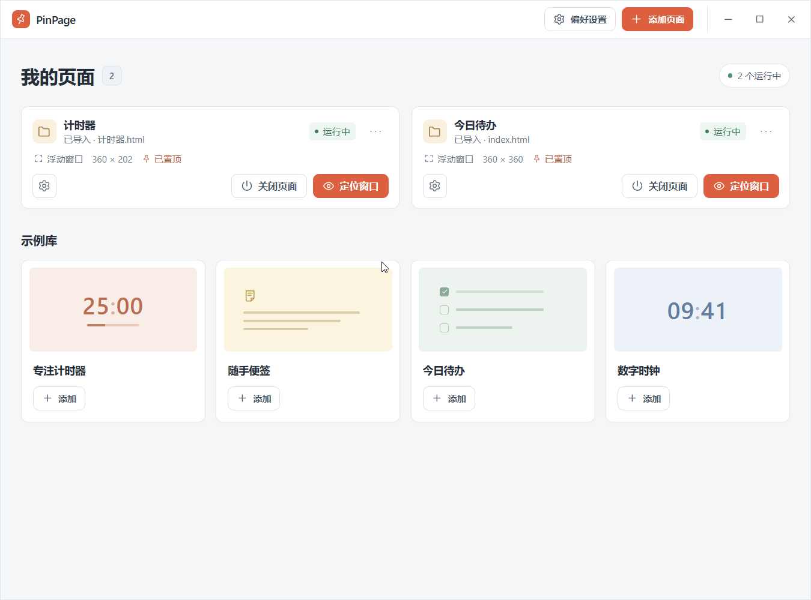
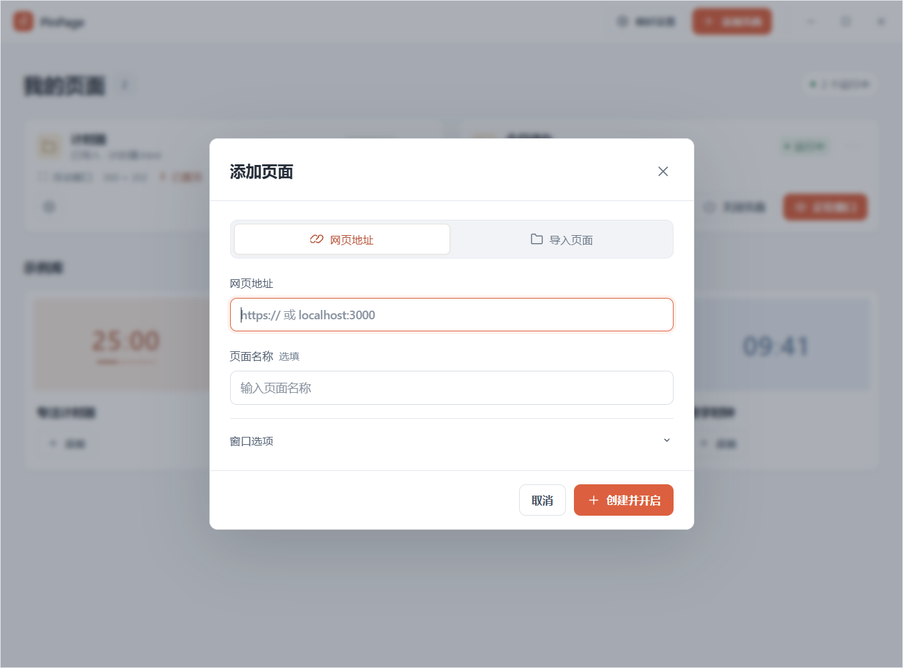
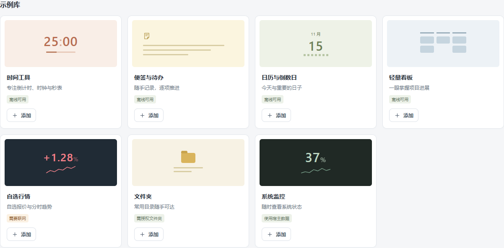
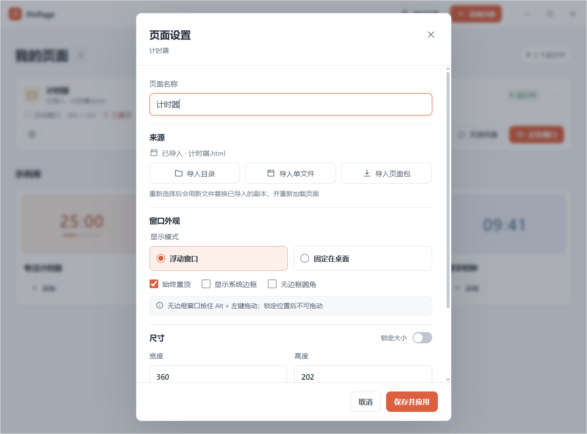
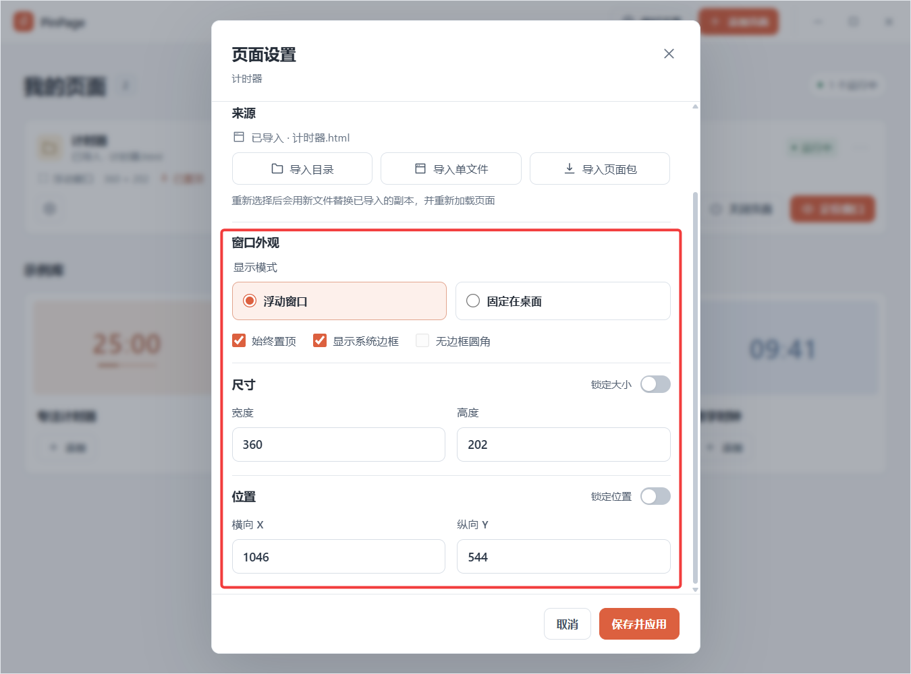
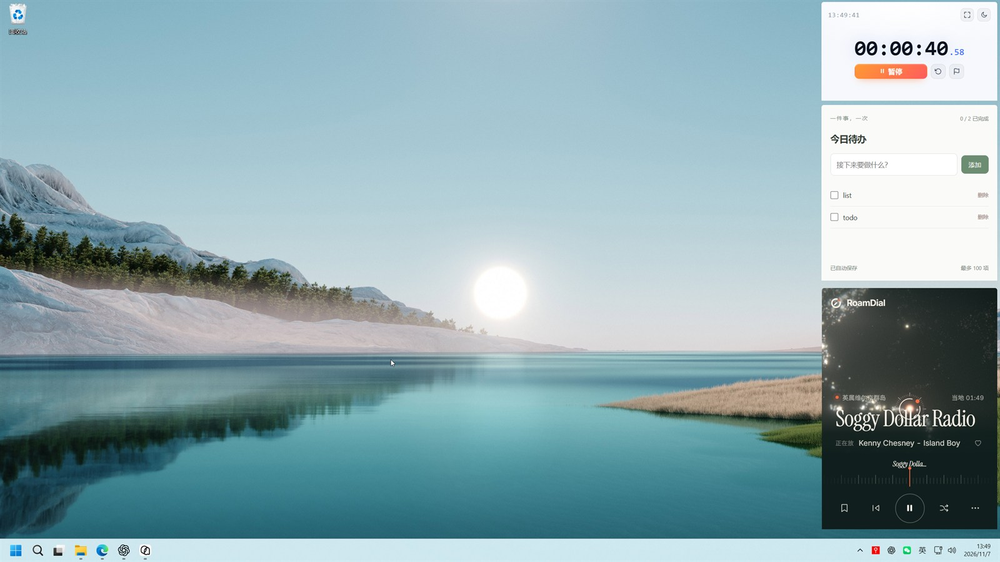
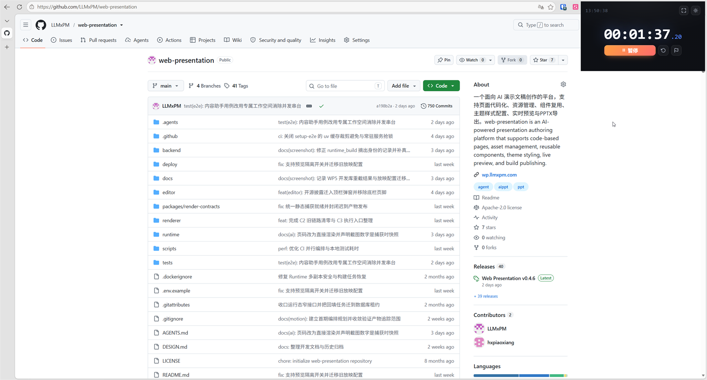
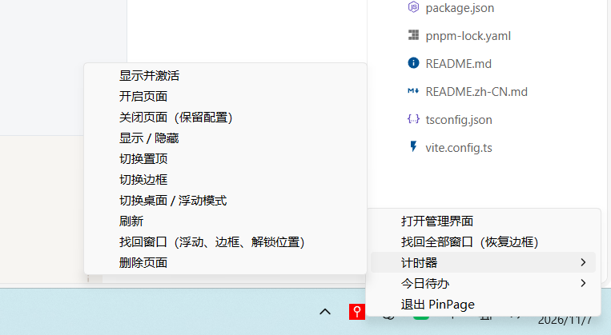
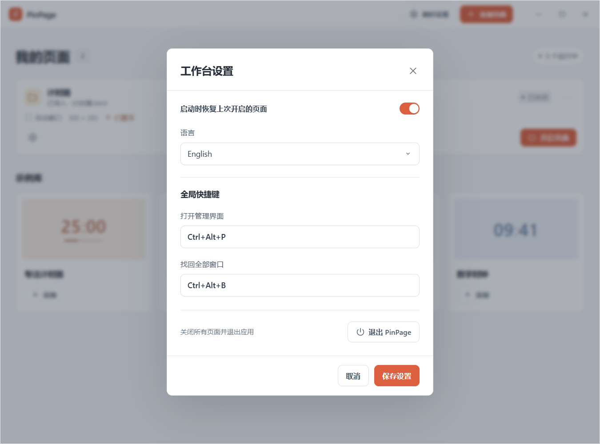

# PinPage 用户指南

PinPage 把在线网页和本地 HTML 变成常驻桌面的小工具，适合需要随时查看的计时器、看板、便签和工具页。首版面向 Windows，按 1～5 个常用页面设计。

## 安装与启动

- 从项目的 GitHub Releases 页面下载 Windows 安装包并运行，或直接运行 `pinpage.exe`；首次启动会打开工作台。
- 以 `--tray` 参数启动时只创建托盘，并按设置恢复上次开启的页面，工作台按需打开。
- 在「设置 → 通用」开启「开机自启」并保存后，登录 Windows 时自动启动到托盘，不弹出工作台；默认关闭。关闭此开关并保存即可取消，是否恢复页面由「启动时恢复上次开启的页面」独立控制。
- 关闭工作台不会退出应用，已开启的页面继续运行；通过托盘重新打开工作台。
- 需要完全退出时，使用设置弹窗左下角的「退出 PinPage」，或托盘菜单中的退出操作。


*工作台：顶栏、页面卡片与示例库入口。*

## 检查和安装更新

在「设置 → 关于」检查、下载和安装更新，并查看状态、更新说明与当前版本。下载并验签通过后选择「安装并重启」。应用只从本仓库 GitHub Releases 获取更新；默认每天自动检查一次，只提示，不自动下载或安装。

下载期间页面继续运行，关闭工作台后下载也会继续；忽略版本或关闭自动检查的选择立即保存。安装前请先在各页面保存内容，确认后会关闭全部页面并重启；未保存的网页状态或计时状态可能丢失。网络或验签失败不会执行安装，可重试或打开 GitHub Release 手动下载安装。

`0.1.0` 等尚未接入 updater 的版本需要先手动安装一次新版。开发构建和独立验证实例不启用应用内升级。真实安装验收状态见[开发与构建](development.md#当前状态与验收)，发布流程见[版本与升级](releases.md)。

## 工作台速览

- 顶栏提供「添加页面」和「设置」；顶栏的「设置」打开应用设置。
- 每张卡片包含页面名称、来源、运行状态，以及按状态出现的开启、显示或重新加载主操作。
- 卡片上的「设置」打开页面设置；「更多」提供刷新、置顶、边框、找回窗口、导出页面包和删除页面。
- 关闭工作台会销毁工作台的 WebView，页面窗口不受影响。

## 添加页面

1. 点击顶栏「添加页面」。
2. 选择来源：网页地址、导入本地页面，或在示例库中直接添加工具。
3. 按需展开「窗口选项」，选择浮动窗口或固定在桌面，并决定是否置顶、是否显示系统边框。
4. 点击「创建并开启」。

新建页面默认使用无边框外观；需要系统标题栏和边框时，可在创建时或页面设置中重新打开。


*添加页面：网页地址与导入页面两种入口。*

### 网页地址

- 支持 HTTP/HTTPS 地址，常见的无协议地址会自动补全。
- 本地前端项目可通过开发服务器地址打开，例如 `http://localhost:3000`。
- 页面中的新窗口链接交给默认浏览器，不在应用内创建弹窗。

### 导入本地页面

- **目录导入**：以所选目录为站点根，入口取根目录下的 HTML；CSS、JS、图片和 JSON 等相对资源会一并复制。
- **单文件导入**：只复制入口 HTML，适合不依赖同级资源的页面。
- **页面包导入**：恢复此前导出的 `.pinpage` 页面包。

导入内容会复制到应用数据目录，之后移动、改名或删除原始文件都不影响页面。单次导入上限为 4000 个文件或 256 MiB，符号链接和目录联接会被跳过；路径可以包含中文和空格。

用大模型生成的本地 HTML 工具也可以直接导入运行，不必部署到服务器或打包成桌面应用。

### 示例库

示例库提供六个工具，每次添加都会生成独立的导入页，可单独设置、导出和删除：

| 示例 | 功能 | 独立预览 |
| --- | --- | --- |
| 专注计时器 | 预设时长、暂停和基于截止时间的计时；localStorage 保存状态，IndexedDB 记录完成轮次 | [计时器](../examples/timer/site/index.html) |
| 随手便签 | 标题与正文随输入自动保存到 localStorage | [便签](../examples/notes/site/index.html) |
| 今日待办 | 添加、勾选和删除任务，最多 100 项，localStorage 保存清单 | [待办](../examples/checklist/site/index.html) |
| 数字时钟 | 简约、翻页与表盘三种外观，浅色、深色和苔绿配色；自适应桌面组件布局，保存显示偏好 | [时钟](../examples/clock/site/index.html) |
| 文件夹 | 经原生选择器逐页授权后只读浏览目录，打开文件或在资源管理器中定位；保存隐藏文件偏好 | [文件夹](../examples/folder/site/index.html) |
| 系统监控 | 读取宿主共享采样的 CPU、内存、网络、磁盘与电池；透明深色面板，CPU 迷你曲线 | [系统监控](../examples/system-monitor/site/index.html) |

示例页内容使用中文，不随工作台语言切换。计时器、时钟、文件夹和系统监控使用 ES 模块，建议通过开发服务预览或导入后使用；便签和待办可以直接打开。文件夹与系统监控在普通浏览器中只展示明确标注的演示数据，真实能力需要在 PinPage 内使用。

文件夹组件首次打开时点击「选择文件夹」授权一个目录，之后只读浏览：点击目录进入、面包屑返回，点击文件用系统默认程序打开，行尾按钮在资源管理器中定位。授权只针对当前页面，更换页面来源会清除，导出页面包不携带授权；目录失效时会提示重新选择。工具栏可刷新、切换隐藏文件和更换授权目录。单次列举最多 2000 条，超出会提示截断。

系统监控随包预设为 `320 × 210` 无边框透明浮动窗。数据来自宿主约每秒一次的共享采样，多个监控页不会重复采样；窗口隐藏时页面自动降低轮询频率。启动初期采样未就绪时显示「等待采样」。电池信息仅笔记本提供，台式机显示「电源已接通」。

时钟右上角的「时钟设置」可调整样式、配色、无底板／柔光卡片、秒数、日期与 12 小时制，修改后自动保存。旧版的秒数偏好会保留；存储不可用时仍可临时调整。布局随窗口比例自动变化，可尝试 `360 × 220` 常规、`480 × 120` 横条、`180 × 320` 竖排或 `240 × 240` 方形；极小窗口优先显示时间，设置面板可滚动访问。关闭秒数时每分钟更新，开启时每秒更新，恢复可见或休眠返回后按系统时间校正。

新版时钟随包预设为 `360 × 220` 无边框浮动窗，并请求背景透明；在「窗口设置」中可改为桌面模式。不支持透明的平台由宿主回退。开启背景透明并选择无底板可直接露出桌面，深色配色使用浅色文字以适配深色壁纸，柔光卡片保留半透明底板。新版样式需要重新添加示例，现有副本不会自动覆盖。

内置示例采用标准 `.pinpage` 页面包，附带适合各工具的默认窗口布局。开发者可运行 `pnpm examples:pack` 生成可独立导入和分享的文件，详见[页面包与示例制作](page-packages.md)。

另提供[自选行情联网验证示例](../examples/stocks/README.md)，尚未加入内置示例库。运行 `pnpm examples:pack` 后导入 `dist/examples/stocks.pinpage`，或在已有开发服务中访问 `/examples/stocks/site/index.html`。在 PinPage 窗口设置中可尝试 `280 × 420` 紧凑、`400 × 640` 标准或 `720 × 440` 宽屏；布局自动适配，滚动条隐藏后仍可滚轮或键盘滚动。点击自选切换真实分时，图表可用鼠标或左右方向键查看价格。设置提供深浅主题、柔光底板／无底板、底板不透明度和分时开关；背景透明由宿主控制，关闭透明时恢复完整底色。行情需要联网，失败保留缓存，上游可能延迟或不可用，请以报价时间与分时日期为准。已导入的旧副本需重新导入或更换来源才能使用新版页面。


*示例库：六个可独立添加的工具，其中文件夹与系统监控使用宿主原生能力。*

## 管理页面

### 卡片操作

卡片把“运行、可见、层级”分开处理，同一个按钮不会既叫“显示”又叫“定位”：

- **运行**：未开启时显示「开启页面」；已开启后可在卡片上「关闭页面」。关闭会释放页面的 WebView 并保留设置，页面内部状态不会保留。
- **可见**：窗口隐藏时主按钮是「显示页面」，显示会同时取消最小化并聚焦浮动窗口；窗口可见时同一位置换成「隐藏页面」，页面继续运行。
- **层级**：浮动窗口可见时，卡片上另有「带到最前」图标，把被遮挡或完全移出屏幕的窗口拉回当前屏幕并聚焦。桌面模式嵌在 Explorer 桌面层，不提供这一项；需要查看时隐藏后再显示，或先最小化其他窗口。
- **加载失败**：主按钮变为「重新加载」；窗口隐藏时优先显示窗口。

页面正常可见时不会出现橙色主按钮；「显示 / 隐藏」只在卡片上出现一次，「⋯」菜单不再重复。

### 页面设置

「设置」分为「窗口」和「内容」，默认打开「窗口」：

- **内容**：修改页面名称；网页页修改地址，导入页重新选择目录、单文件或页面包。点击「保存内容」才提交，只有来源确实改动时才重新加载页面，修改名称不会重置窗口布局或预设标记。
- **窗口外观**：显示模式（浮动窗口／固定在桌面）、三选一的边框样式（系统边框／无边框／无边框圆角），以及同排的「始终置顶」与「页面背景透明」开关。桌面模式固定无边框，切回浮动窗口后沿用此前的边框选择。
- **页面背景透明**：独立于边框样式，Windows 下可逐页开启，默认关闭；切换不会刷新或重建页面，文字、图片与控件保持自身外观。开启后保留网页原样，不会自动删除网站的不透明背景，也不会开启鼠标穿透。系统标题栏仍使用系统外观。
- **尺寸与位置**：宽、高（80～8192 × 60～8192 逻辑像素）与屏幕坐标；大小锁和位置锁独立生效，开关就近放在分组标题右侧。

窗口开关、显示模式和预设立即生效并保存；尺寸和坐标在回车或离开输入框后提交，临时空值和非法数字不会应用。页面关闭时只保存设置，下次开启生效，不会自动打开页面。

移动或缩放窗口会同步到尚未编辑的字段；正在修改的字段保留输入，底栏显示实际尺寸与坐标。未生效输入和应用失败也在底栏提示；失败时输入保留，可重新提交或「恢复实际值」。位置锁和大小锁互不影响，锁定后仍可明确输入新数值。

「撤销上次调整」位于弹窗底栏，只还原上一次字段调整涉及的窗口字段，不覆盖名称、来源或未涉及的几何；切换预设会清除该页的撤销记录。字段已被后续操作改动时，旧撤销会被拒绝。「完成」关闭设置；有未保存内容或未生效输入时会先确认放弃，已经生效的窗口设置会保留。

#### 窗口预设

预设把“外观 + 尺寸 + 位置”打包成一次切换，避免逐个勾选。应用不再附带只读的内置预设；可用「另存为新预设」保存当前窗口，也可以导入页面包携带的命名模板。导入列表与应用随包默认布局是两个独立选择。

- 位置按目标显示器可用区域的**相对比例**保存，换分辨率、改 DPI 或换一块屏后仍落在相同的相对位置；勾选「全屏」的预设在应用时按目标显示器整屏铺满，覆盖任务栏区域。
- 桌面模式不置顶；选择系统边框时圆角不生效，这两条在应用预设时会自动收敛。
- 切换入口有三处：卡片「⋯」菜单、页面设置顶部的预设快捷条、窗口右键原生菜单，任一处都立即生效。
- 切换会同时改变尺寸与位置；预设不提供撤销，重新选择其他预设或手动调整即可恢复。
- 勾选表示当前匹配的预设；拖动、缩放或调整窗口参数后，不再匹配时显示为自定义。名称与来源修改不影响标记。
- 「另存为新预设」会等待窗口设置应用完成，再保存当前外观、尺寸和相对位置；失败时保留名称输入，不需要关闭后重新打开设置。
- 选择过自定义预设后，可以用「更新“预设名”」将当前窗口配置覆盖到该模板，覆盖前会确认。
- 从页面设置的「管理预设」或「设置 → 操作 → 自定义预设 → 管理预设」打开同一个管理器。预设可以编辑名称、外观（含边框样式与页面背景）、尺寸、两把锁、全屏模式，以及九宫格或百分比相对位置。
- 模板修改只影响以后应用它的结果；删除前会确认，现有页面保留外观、位置和内容。


*页面设置：来源与窗口外观。*


*窗口外观、尺寸、位置与就近的锁定开关。*

### 关闭、隐藏与删除

- **隐藏**：保留页面运行状态，随时从卡片或托盘显示。
- **关闭页面**：释放该页面的 WebView，保留卡片、来源和窗口设置；下次启动保持关闭，重新开启会再次加载页面。
- **删除页面**：确认后从列表移除，并永久删除页面设置及导入副本。

## 窗口操作

- 默认先按住 **Ctrl**，再用左键拖动无边框且未锁定位置的窗口；Ctrl+左键即可移动窗口。先按鼠标再按修饰键，不会中途接管网页操作。
- 在页面客户区**直接右键**打开原生窗口菜单，无需修饰键（Ctrl+右键同样有效）：顶部平铺窗口预设，单选勾选、切换立即生效；无匹配预设时显示禁用的「自定义」行，尚无预设时提示到页面设置保存。分隔线后是「页面设置…」、刷新、隐藏、关闭。「页面设置…」会打开管理界面并直接弹出该页的设置弹窗，外观、锁定、几何与内容都在那里调整；菜单不提供删除。
- 页面自带右键菜单时（部分看板、编辑器或本地工具），可在「页面设置 → 窗口」开启「让页面处理右键」，直接右键就完整交给页面；按住修饰键的右键始终打开窗口菜单，不受该开关影响。内容页已禁用 WebView 自带的浏览器右键菜单，开关开启且页面没有自定义菜单时，直接右键不会弹出任何菜单。
- 左键拖动与修饰键+右键共用「设置 → 操作」中的手势修饰键，可选 Ctrl、Shift（左右均可）或关闭。保存后生效，正在进行的手势仍按原归属收尾。直接右键的窗口菜单不受该设置影响，关闭手势后仍可用。
- 左键等其他鼠标操作不接管；直接右键默认打开窗口菜单（可按页面交给网页），精确匹配修饰键的组合操作由 PinPage 使用，会覆盖网页同组合操作。右 Alt／AltGr、额外叠加的修饰键不触发；不安装全局键盘钩子，网页仍可能收到修饰键；手势期间暂时将焦点交给宿主，弹出原生菜单也可能改变焦点。模拟鼠标输入不触发手势。
- 右键须在原窗口内松开才打开菜单；手势期间额外按鼠标键或滚轮会取消动作。拖动使用窗口直接移动，不提供系统标题栏拖动的边缘吸附。
- 手势不可用时仍可使用托盘和管理界面；锁定位置不影响右键菜单。
- 拖动窗口边缘或四角可以调整大小；锁定后仍可通过管理界面明确输入新数值。
- 「无边框圆角」只作用于无边框窗口；选择「系统边框」时使用系统外观。

- **浮动模式**：普通悬浮窗口，可置顶于其他窗口之上。
- **桌面模式**：页面显示在普通应用窗口下方；普通页面嵌入 Explorer 桌面层，透明页面使用保留透明合成能力的桌面底层窗口。切回浮动模式会沿用此前的边框与置顶偏好。
- 显示器布局或 DPI 变化后，恢复窗口时会按当前可用区域校正位置，避免窗口遗留在已断开的屏幕上。


*把需要常驻的页面固定在桌面之上，随时可见。*


*浮动模式：计时器等页面置顶在浏览器等其他窗口之上。*

### 编写透明页面

在“页面设置 → 窗口外观”中开启“页面背景透明”。应用会提供顶层文档 CSS 变量 `--pinpage-background-opacity`：关闭时为 `1`，开启时为 `0`。页面可使用它切换背景，同时保留文字和按钮的清晰度：

```css
/* 功能：按 PinPage 的透明偏好切换页面背景，普通浏览器仍显示原底色。 */
html,
body {
  background: rgb(250 251 248 / var(--pinpage-background-opacity, 1));
}
```

页面也可以始终使用 `background: transparent`，或自行绘制带 alpha 的半透明面板。需要同时检查 `html`、`body` 及铺满页面的容器；嵌套容器、图片、Canvas 和 iframe 中的不透明内容仍会遮挡桌面。应用不提供任意网页通用的背景透明度滑块。内容页另受独立 CSP 约束：脚本仅同源随包提供，不能引用 CDN 或内联脚本，禁止 iframe；出站 fetch 允许同源与 HTTPS，详见[架构与数据](architecture.md#权限与安全边界)。

内置示例均已适配透明变量。此前导入的示例是独立副本，不会被升级覆盖；需要重新添加新版示例，或在原副本中适配 CSS。透明偏好随页面配置和窗口预设保存，也会随导出的 `.pinpage` 默认窗口布局携带；新建导入时可选择应用该布局。

窗口难以找到时，可使用托盘的恢复入口：恢复系统边框与位置，并关闭背景透明；页面运行状态继续保留。跨平台加载到暂不支持透明的平台时，该偏好会回退为关闭。

## 托盘与窗口找回

- 应用不注册全局快捷键；通过托盘打开工作台或找回窗口，页面卡片也保留对应操作。
- 托盘中的「找回全部窗口」会把页面切回浮动模式、恢复系统边框、解除位置锁并居中，大小锁保留。
- 托盘菜单提供「打开管理界面」「找回全部窗口（恢复边框）」，以及每个页面的子菜单：带到最前、开启/关闭页面、显示/隐藏、切换置顶、切换边框、切换桌面/浮动模式、刷新、找回窗口和删除页面；桌面模式页面不显示「带到最前」；末尾为退出 PinPage。
- 悬浮页不显示任务栏图标，工作台保留任务栏入口；找不到窗口时优先使用托盘中的「找回全部窗口」或页面卡片。


*托盘菜单：工作台、页面操作与退出。*

## 设置

设置使用单页布局，左侧章节节点可直接跳到「通用」「操作」「关于」。通用和操作中的改动点击「保存设置」后生效；关于中的更新操作即时执行。

- **通用**：语言可选简体中文、English 或跟随系统，保存后立即生效，不刷新、不重建已打开的页面；「启动时恢复上次开启的页面」控制下次启动是否重新打开退出前仍开启的页面，并恢复窗口位置与大小。
- **开机自启**：位于通用章节，点击「保存设置」后注册或移除当前 Windows 用户的登录启动项，无需管理员权限。注册指向当前可执行文件，移动或删除程序后需要重新设置；状态读取失败时仅禁用此开关，其他设置仍可保存。其他平台暂不可用。
- **操作**：选择左键拖动与修饰键+右键共用的手势修饰键（Ctrl、Shift 或关闭），默认 Ctrl；直接右键的窗口菜单不受该设置影响。
- **关于**：查看当前版本、更新状态与说明，手动检查、下载和安装更新；自动检查开关更改后立即保存。
- 弹窗左下角的「退出 PinPage」会关闭所有页面并结束应用。


*设置：单页章节、左侧快速定位与左下角退出入口。*

## 页面数据与迁移

- 导入页的站点副本保存在 `%APPDATA%\com.pinpage.desktop\pages\{页面 ID}\site`。
- 「更多 → 导出页面包」把已开启的导入页与页面数据打包为 `.pinpage`；新建页面时用「导入页面包」恢复。
- 导出包携带当前窗口的外观、尺寸、相对位置和该页命名预设列表（名称、顺序和全部参数）；新建时可分别选择「导入随包窗口预设」和「应用随包默认布局」，取消应用布局后可手动设置。旧包没有布局时按原有方式创建；更换已有页面的来源保持窗口设置。
- 页面数据覆盖 localStorage、sessionStorage 与 IndexedDB，不包含 Cookie 和 HTTP 缓存；跨机器恢复登录态并不完整。
- 工作台导出要求页面开启；数据读取超时仍导出站点、默认布局和命名预设，并说明未包含数据。CLI 默认不采集个人存储，关闭页也可导出；显式 `--with-data true` 才要求运行页。
- 随包数据只在页面首次打开时写入一次，之后不再覆盖用户改动。
- 更换导入来源沿用同一个页面 ID，`pinpage://{页面 ID}` 来源下的本地存储继续保留；改为新的网页地址后使用该地址自己的存储。
- 刷新、关闭或重启不会恢复页面完整的 JS 内存状态，运行进度取决于页面自身的保存能力。

## 常见问题

**导入时提示文件过多或体积过大？**
单次上限为 4000 个文件或 256 MiB。先精简目录，或只导入入口页面及必要资源。

**导入后页面空白或资源缺失？**
目录导入只认所选目录根部的 HTML 入口；确认入口文件存在，且页面使用相对路径引用同级资源。单文件导入不会携带 CSS、JS 和图片。

**页面加载失败或被拦截？**
检查地址协议是否为 HTTP/HTTPS；应用只允许页面在当前来源范围内导航。修改来源后，导航白名单会按新来源更新。

**登录流程打不开？**
依赖应用内弹窗的登录流程需要按站点验证；新窗口链接会交给默认浏览器。

**找不到页面窗口？**
点击浮动窗口卡片上的「带到最前」、隐藏页面的「显示页面」，或在托盘中选择「找回全部窗口」；隐藏的页面也可以从卡片或托盘恢复显示。

**第三方计时器时间不准？**
应用负责窗口展示，计时实现由页面自身决定；后台节流、休眠恢复等行为需要页面自行处理。

**切换语言后示例页还是中文？**
示例页是独立工具页面，内容固定为中文，不随工作台语言变化。

## 已知限制

- 首版以 Windows 为目标平台，同时使用 1～5 个轻量页面；复杂看板和长时间运行需要单独评估。
- macOS 目前只提供标准浮动窗口，桌面模式、圆角、位置锁、大小锁和窗口手势不可用，且尚未实机验收；详见[平台支持](platforms.md)。
- 持续可见的页面默认不挂起；隐藏窗口也不等于释放内存。
- 桌面模式位于普通应用窗口下方，独占全屏和系统安全桌面等场景不在首版保证范围内。
- 安装包在干净环境中的安装、卸载，以及部分 DPI 与多显示器组合仍在验收中，详见[开发与构建](development.md#当前状态与验收)。

## 智能体 CLI 与技能（未发布）

当前源码新增随应用提供的 `pinpage-cli.exe`，可安装、更新和诊断页面、管理命名窗口预设、导出页面包并采集真实桌面。工作台顶栏的独立「智能体与 CLI」面板提供本机控制开关，以及公开技能的用户目录／指定目录安装更新和目录／ZIP 导出。源码授权不等于内容页文件夹授权；后者仍需原生选择器逐页确认。命令、失败恢复和离线技能管理见[CLI 指南](agent-cli.md)，实际覆盖范围见[当前状态与验收](development.md#当前状态与验收)。
