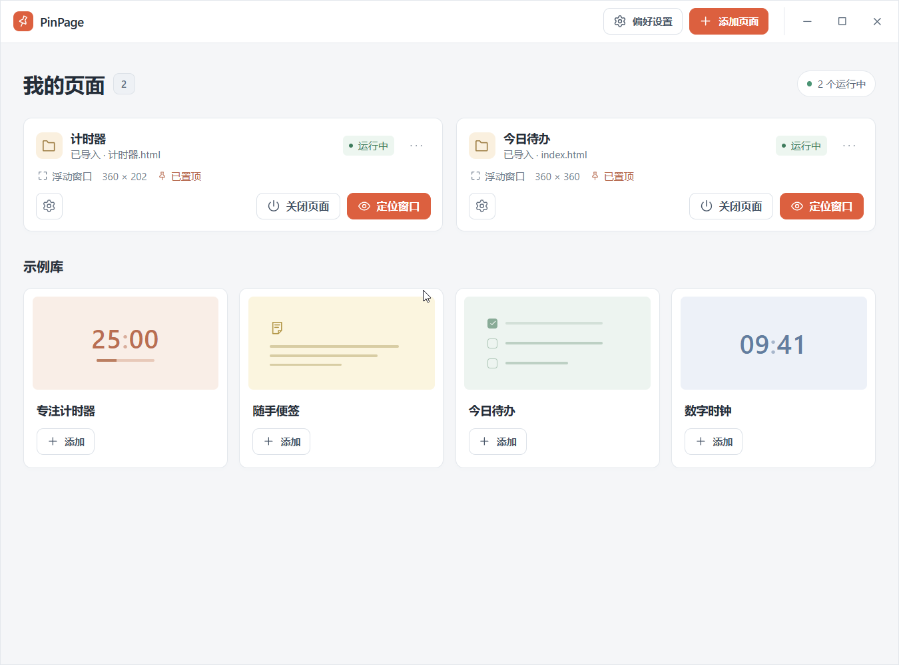
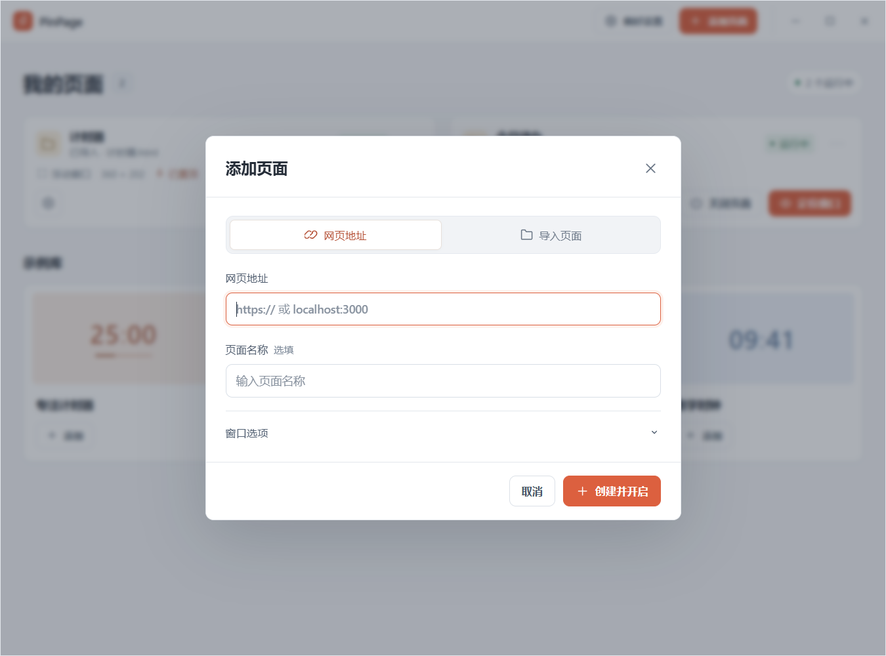
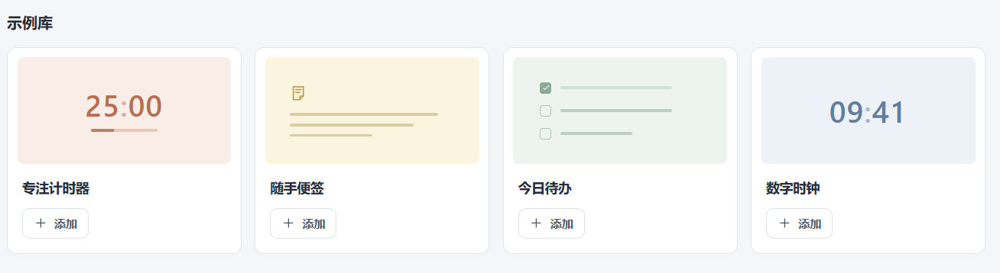
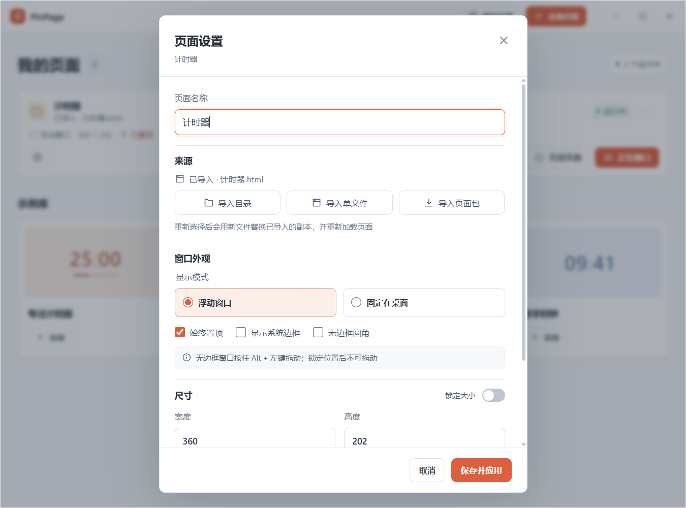
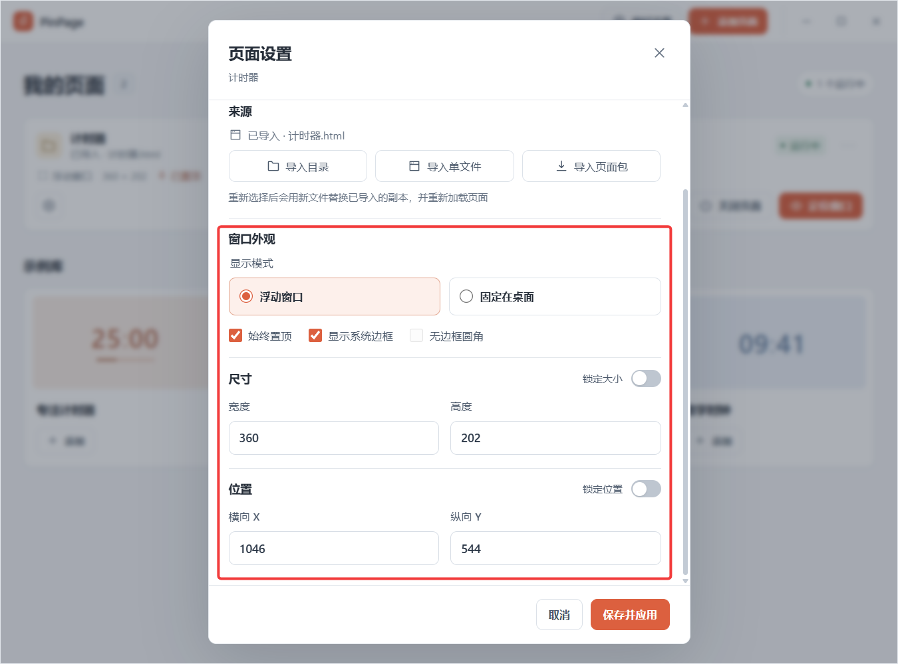
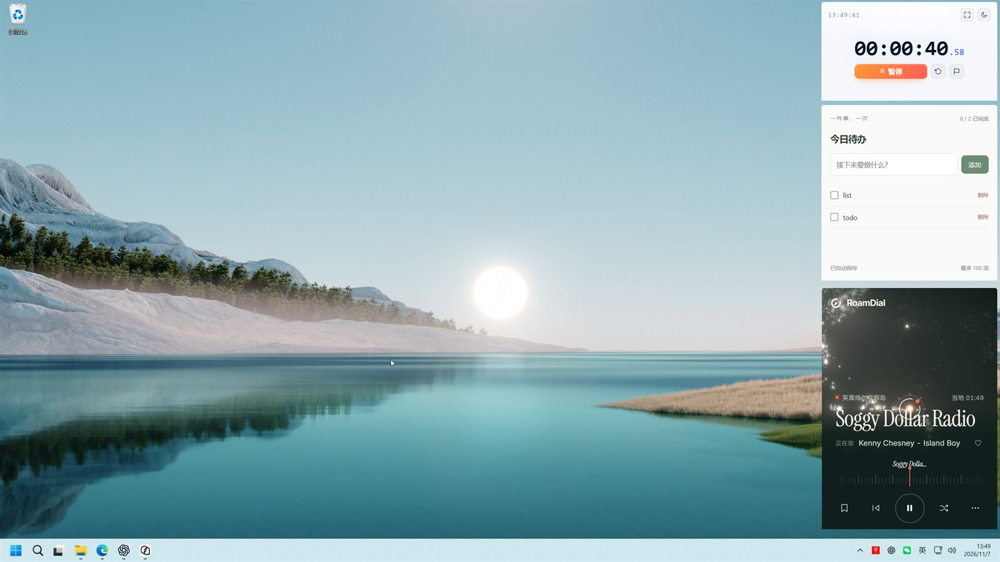
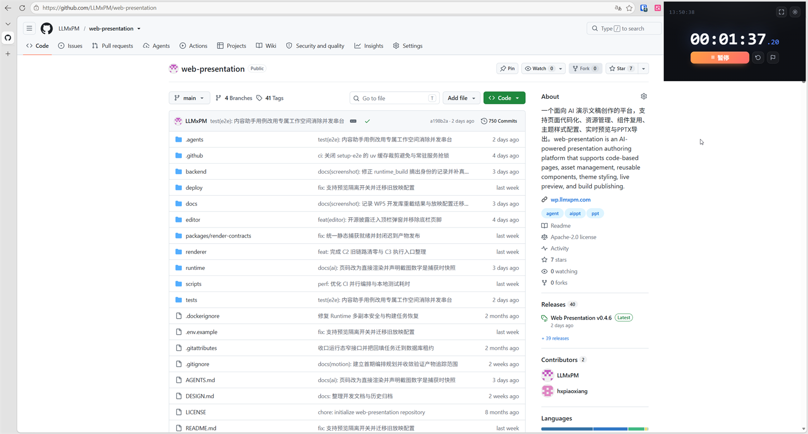
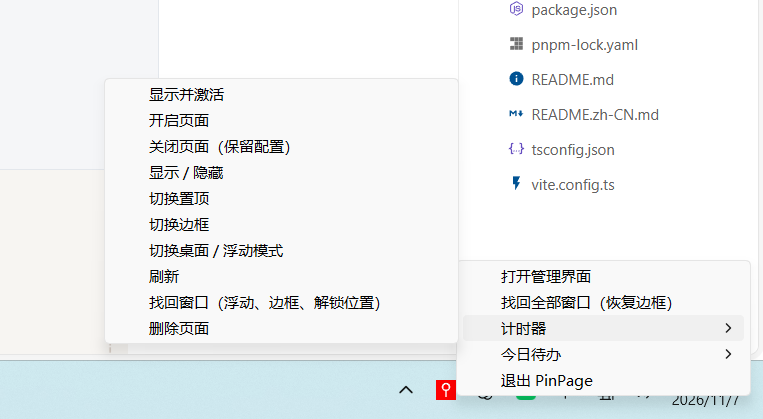
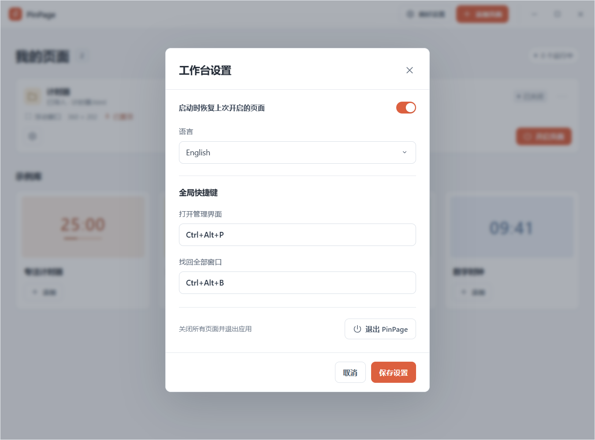

# PinPage 用户指南

PinPage 把在线网页和本地 HTML 变成常驻桌面的小工具，适合需要随时查看的计时器、看板、便签和工具页。首版面向 Windows，按 1～5 个常用页面设计。

## 安装与启动

- 从项目的 GitHub Releases 页面下载 Windows 安装包并运行，或直接运行 `pinpage.exe`；首次启动会打开工作台。
- 以 `--tray` 参数启动时只创建托盘，并按设置恢复上次开启的页面，工作台按需打开。
- 关闭工作台不会退出应用，已开启的页面继续运行；通过托盘重新打开工作台。
- 需要完全退出时，使用设置弹窗左下角的「退出 PinPage」，或托盘菜单中的退出操作。

*工作台：顶栏、页面卡片与示例库入口。*

## 检查和安装更新

在「设置 → 关于」检查、下载和安装更新，并查看状态、更新说明与当前版本。下载并验签通过后选择「安装并重启」。应用只从本仓库 GitHub Releases 获取更新；默认每天自动检查一次，只提示，不自动下载或安装。

下载期间页面继续运行，关闭工作台后下载也会继续；忽略版本或关闭自动检查的选择立即保存。安装前请先在各页面保存内容，确认后会关闭全部页面并重启；未保存的网页状态或计时状态可能丢失。网络或验签失败不会执行安装，可重试或打开 GitHub Release 手动下载安装。

`0.1.0` 等尚未接入 updater 的版本需要先手动安装一次新版。开发构建和独立验证实例不启用应用内升级。真实安装验收状态见[验证记录](verification.md)，发布流程见[版本与升级](releases.md)。

## 工作台速览

- 顶栏提供「添加页面」和「设置」；顶栏的「设置」打开应用设置。
- 每张卡片包含页面名称、来源、运行状态，以及按状态出现的开启、显示或重新加载主操作。
- 卡片上的「设置」打开页面设置；「更多」提供刷新、置顶、边框、找回窗口、导出页面包和删除页面。
- 关闭工作台会销毁工作台的 WebView，页面窗口不受影响。

## 添加页面

1. 点击顶栏「添加页面」。
2. 选择来源：网页地址、导入本地页面，或在示例库中直接添加工具。
3. 按需展开「窗口选项」，选择浮动窗口或固定在桌面，并决定是否置顶、是否显示系统边框。
4. 点击「创建并开启」。

新建页面默认使用无边框外观；需要系统标题栏和边框时，可在创建时或页面设置中重新打开。

*添加页面：网页地址与导入页面两种入口。*

### 网页地址

- 支持 HTTP/HTTPS 地址，常见的无协议地址会自动补全。
- 本地前端项目可通过开发服务器地址打开，例如 `http://localhost:3000`。
- 页面中的新窗口链接交给默认浏览器，不在应用内创建弹窗。

### 导入本地页面

- **目录导入**：以所选目录为站点根，入口取根目录下的 HTML；CSS、JS、图片和 JSON 等相对资源会一并复制。
- **单文件导入**：只复制入口 HTML，适合不依赖同级资源的页面。
- **页面包导入**：恢复此前导出的 `.pinpage` 页面包。

导入内容会复制到应用数据目录，之后移动、改名或删除原始文件都不影响页面。单次导入上限为 4000 个文件或 256 MiB，符号链接和目录联接会被跳过；路径可以包含中文和空格。

用大模型生成的本地 HTML 工具也可以直接导入运行，不必部署到服务器或打包成桌面应用。

### 示例库

示例库提供四个离线工具，每次添加都会生成独立的导入页，可单独设置、导出和删除：

| 示例 | 功能 | 独立预览 |
| --- | --- | --- |
| 专注计时器 | 预设时长、暂停和基于截止时间的计时；localStorage 保存状态，IndexedDB 记录完成轮次 | [计时器](../examples/timer/index.html) |
| 随手便签 | 标题与正文随输入自动保存到 localStorage | [便签](../examples/widgets/notes.html) |
| 今日待办 | 添加、勾选和删除任务，最多 100 项，localStorage 保存清单 | [待办](../examples/widgets/checklist.html) |
| 数字时钟 | 当前本地日期、星期与时间，记忆显示秒数的偏好 | [时钟](../examples/widgets/clock.html) |

示例页内容使用中文，不随工作台语言切换。计时器包含 ES 模块和 JSON 请求，建议通过开发服务预览或导入后使用；便签和待办可以直接打开。

*示例库：四个可独立添加的离线工具。*

## 管理页面

### 卡片操作

卡片把“运行、可见、层级”分开处理，同一个按钮不会既叫“显示”又叫“定位”：

- **运行**：未开启时显示「开启页面」；已开启后可在卡片上「关闭页面」。关闭会释放页面的 WebView 并保留设置，页面内部状态不会保留。
- **可见**：窗口隐藏时主按钮是「显示页面」，显示会同时取消最小化并聚焦浮动窗口；窗口可见时同一位置换成「隐藏页面」，页面继续运行。
- **层级**：浮动窗口可见时，卡片上另有「带到最前」图标，把被遮挡或完全移出屏幕的窗口拉回当前屏幕并聚焦。桌面模式嵌在 Explorer 桌面层，不提供这一项；需要查看时隐藏后再显示，或先最小化其他窗口。
- **加载失败**：主按钮变为「重新加载」；窗口隐藏时优先显示窗口。

页面正常可见时不会出现橙色主按钮；「显示 / 隐藏」只在卡片上出现一次，「⋯」菜单不再重复。

### 页面设置

「设置」中可以调整：

- **来源**：网页页修改地址；导入页重新选择目录、单文件或页面包。只有来源确实改动时才会重新加载页面。
- **窗口外观**：浮动窗口或固定在桌面、始终置顶、系统边框、无边框圆角。
- **尺寸**：宽、高，以及独立的大小锁。
- **位置**：屏幕坐标，以及独立的位置锁。

页面设置打开期间，移动或缩放窗口会同步到尚未编辑的字段；正在修改的字段会保留草稿。位置锁和大小锁互不影响，锁定后仍可在设置中输入新数值。

#### 窗口预设

预设把“外观 + 尺寸 + 位置”打包成一次切换，避免逐个勾选：

| 预设 | 模式 | 边框 | 圆角 | 置顶 | 位置锁 | 大小锁 | 尺寸 | 位置 |
| --- | --- | --- | --- | --- | --- | --- | --- | --- |
| 标准窗口 | 浮动 | 有 | 关 | 否 | 否 | 否 | 960 × 720 | 居中 |
| 极简悬浮 | 浮动 | 无 | 开 | 是 | 是 | 否 | 420 × 360 | 右上角 |
| 桌面贴纸 | 桌面 | 无 | 开 | 否 | 是 | 是 | 320 × 480 | 右下角 |
| 只读看板 | 浮动 | 无 | 开 | 否 | 是 | 是 | 520 × 640 | 右侧居中 |

- 位置按目标显示器可用区域的**相对比例**保存，换分辨率、改 DPI 或换一块屏后仍落在相同的相对位置。
- 桌面模式不置顶；有系统边框时圆角不生效，这两条在应用预设时会自动收敛。
- 切换入口有三处：卡片「⋯」菜单、页面设置顶部的预设行、窗口右键原生菜单，任一处都立即生效。
- 切换会同时改变尺寸与位置，工作台会给出可撤销提示；撤销会还原切换前的完整外观与几何。
- 之后手动调整任一外观或几何字段，预设标记即退化为“自定义”，需要重新点选才会回到某个预设。
- 页面设置里有未保存的修改时，预设行不可点，避免随后的保存覆盖切换结果。
- 「存为预设」把当前页面已保存的外观与位置另存为自定义预设；自定义预设在「设置 → 操作 → 自定义预设」删除，内置预设只读。

*页面设置：来源与窗口外观。*

*窗口外观、尺寸、位置与就近的锁定开关。*

### 关闭、隐藏与删除

- **隐藏**：保留页面运行状态，随时从卡片或托盘显示。
- **关闭页面**：释放该页面的 WebView，保留卡片、来源和窗口设置；下次启动保持关闭，重新开启会再次加载页面。
- **删除页面**：确认后从列表移除，并永久删除页面设置及导入副本。

## 窗口操作

- 默认先按住**左 Alt**，再用左键拖动无边框且未锁定位置的窗口；Alt+左键即可移动窗口。先按鼠标再按修饰键，不会中途接管网页操作。
- 在页面客户区使用 **左 Alt + 右键**打开原生窗口菜单，可切换置顶、桌面模式、边框、圆角、位置锁与大小锁，也可刷新、隐藏、打开管理界面或关闭页面。开关显示当前状态；桌面模式禁用置顶与边框项；菜单不提供删除。「窗口预设」子菜单会勾选当前基于的预设。
- 使用 Alt 时，Alt+右键需先松开右键，再松开 Alt；菜单会在 Alt 释放后出现并保持打开。按住 Alt 产生的键盘自动重复会关闭系统菜单，因此不会在按住 Alt 时弹出。
- 两种手势共用「设置 → 操作」中的手势修饰键，可选 Alt（仅左侧）、Ctrl、Shift（左右均可）或关闭。保存后生效，正在进行的手势仍按原归属收尾。
- 普通鼠标操作不接管；只有精确匹配修饰键的组合操作由 PinPage 使用，会覆盖网页同组合操作。右 Alt／AltGr、额外叠加的修饰键不触发；不安装全局键盘钩子，网页仍可能收到修饰键；手势期间暂时将焦点交给宿主，弹出原生菜单也可能改变焦点。模拟鼠标输入不触发手势。
- 右键须在原窗口内松开才打开菜单；手势期间额外按鼠标键或滚轮会取消动作。拖动使用窗口直接移动，不提供系统标题栏拖动的边缘吸附。
- 手势不可用时仍可使用托盘和管理界面；锁定位置不影响右键菜单。
- 拖动窗口边缘或四角可以调整大小；锁定后仍可通过管理界面明确输入新数值。
- 圆角只作用于无边框窗口，有系统边框时使用系统外观。
- **浮动模式**：普通悬浮窗口，可置顶于其他窗口之上。
- **桌面模式**：页面嵌入 Explorer 桌面图标宿主，显示在普通应用窗口下方；切回浮动模式会沿用此前的边框与置顶偏好。
- 显示器布局或 DPI 变化后，恢复窗口时会按当前可用区域校正位置，避免窗口遗留在已断开的屏幕上。

*把需要常驻的页面固定在桌面之上，随时可见。*

*浮动模式：计时器等页面置顶在浏览器等其他窗口之上。*

## 托盘与窗口找回

- 应用不注册全局快捷键；通过托盘打开工作台或找回窗口，页面卡片也保留对应操作。
- 托盘中的「找回全部窗口」会把页面切回浮动模式、恢复系统边框、解除位置锁并居中，大小锁保留。
- 托盘菜单提供「打开管理界面」「找回全部窗口（恢复边框）」，以及每个页面的子菜单：带到最前、开启/关闭页面、显示/隐藏、切换置顶、切换边框、切换桌面/浮动模式、刷新、找回窗口和删除页面；桌面模式页面不显示「带到最前」；末尾为退出 PinPage。
- 悬浮页不显示任务栏图标，工作台保留任务栏入口；找不到窗口时优先使用托盘中的「找回全部窗口」或页面卡片。

*托盘菜单：工作台、页面操作与退出。*

## 设置

设置使用单页布局，左侧章节节点可直接跳到「通用」「操作」「关于」。通用和操作中的改动点击「保存设置」后生效；关于中的更新操作即时执行。

- **通用**：语言可选简体中文、English 或跟随系统，保存后立即生效，不刷新、不重建已打开的页面；「启动时恢复上次开启的页面」控制下次启动是否重新打开退出前仍开启的页面，并恢复窗口位置与大小。
- **操作**：选择左键拖动与右键菜单共用的手势修饰键（Alt、Ctrl、Shift 或关闭），默认只使用左 Alt，避免与 AltGr 冲突。
- **关于**：查看当前版本、更新状态与说明，手动检查、下载和安装更新；自动检查开关更改后立即保存。
- 弹窗左下角的「退出 PinPage」会关闭所有页面并结束应用。

*设置：单页章节、左侧快速定位与左下角退出入口。*

## 页面数据与迁移

- 导入页的站点副本保存在 `%APPDATA%\com.pinpage.desktop\pages\{页面 ID}\site`。
- 「更多 → 导出页面包」把已开启的导入页与页面数据打包为 `.pinpage`；新建页面时用「导入页面包」恢复。
- 页面数据覆盖 localStorage、sessionStorage 与 IndexedDB，不包含 Cookie 和 HTTP 缓存；跨机器恢复登录态并不完整。
- 导出要求页面处于开启状态；页面未开启或数据读取超时，只打包站点副本并在结果中说明。
- 随包数据只在页面首次打开时写入一次，之后不再覆盖用户改动。
- 更换导入来源沿用同一个页面 ID，`pinpage://{页面 ID}` 来源下的本地存储继续保留；改为新的网页地址后使用该地址自己的存储。
- 刷新、关闭或重启不会恢复页面完整的 JS 内存状态，运行进度取决于页面自身的保存能力。

## 常见问题

**导入时提示文件过多或体积过大？**
单次上限为 4000 个文件或 256 MiB。先精简目录，或只导入入口页面及必要资源。

**导入后页面空白或资源缺失？**
目录导入只认所选目录根部的 HTML 入口；确认入口文件存在，且页面使用相对路径引用同级资源。单文件导入不会携带 CSS、JS 和图片。

**页面加载失败或被拦截？**
检查地址协议是否为 HTTP/HTTPS；应用只允许页面在当前来源范围内导航。修改来源后，导航白名单会按新来源更新。

**登录流程打不开？**
依赖应用内弹窗的登录流程需要按站点验证；新窗口链接会交给默认浏览器。

**找不到页面窗口？**
点击浮动窗口卡片上的「带到最前」、隐藏页面的「显示页面」，或在托盘中选择「找回全部窗口」；隐藏的页面也可以从卡片或托盘恢复显示。

**第三方计时器时间不准？**
应用负责窗口展示，计时实现由页面自身决定；后台节流、休眠恢复等行为需要页面自行处理。

**切换语言后示例页还是中文？**
示例页是独立工具页面，内容固定为中文，不随工作台语言变化。

## 已知限制

- 首版以 Windows 为目标平台，同时使用 1～5 个轻量页面；复杂看板和长时间运行需要单独评估。
- 持续可见的页面默认不挂起；隐藏窗口也不等于释放内存。
- 桌面模式位于普通应用窗口下方，独占全屏和系统安全桌面等场景不在首版保证范围内。
- 安装包在干净环境中的安装、卸载，以及部分 DPI 与多显示器组合仍在验收中，详见[验证记录](verification.md)。
